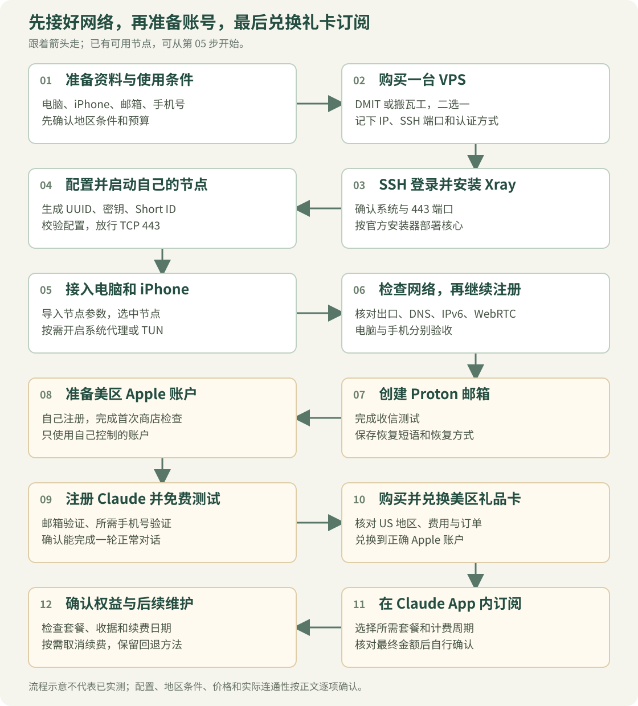

# 从买 VPS 到订阅 Claude 的完整小白教程

从购买 DMIT／搬瓦工，到搭建自己的代理节点、配置电脑和手机、检查 IP 与 DNS，再到注册 Proton、美区 Apple 账户和 Claude，最后通过 App Store 礼品卡完成 Claude 内购与续费管理，按顺序做完这一份即可。

文件：[HTML 阅读版](index.html)（截图和流程图已内嵌，下载单个文件即可离线阅读）。

资料核对日期：**2026 年 10 月 31 日**。电脑以 Windows 为主，手机以 iPhone 为主；服务端步骤以全新 Ubuntu 24.04 LTS 或 Debian 12、systemd、公网 IPv4 为前提。社区经验优先参考近三个月的原帖，关键配置和付款条件再与官方资料核对。

**先让网络和免费账号正常工作，最后再付 Claude 会员费。** 已有可用节点不必重复买 VPS；DMIT 和搬瓦工二选一即可。

> 适用前提：Claude 官方要求实际位于支持地区，并对新账号要求支持地区的手机号。海外出口和美区 Apple 账户不能替代这两个条件。中国大陆未列入本文核对的支持名单。先查看[支持地区](https://support.claude.com/en/articles/8461763-where-can-i-access-claude)和[手机号要求](https://support.claude.com/en/articles/8287232-verify-your-phone-number)，再决定是否投入费用。

## 先看完整流程



*流程示意：先接好网络，再准备账号，最后通过美区礼品卡兑换余额并在 Claude App 内订阅。[打开大图](assets/00-setup-flow.svg)。*

| 你的起点 | 按这个顺序做 |
| --- | --- |
| 从零自建 | 第一节准备 → 第二节买 VPS → 第三节搭节点 → 第四节连接设备 → 第五节验收 → 第六至九节注册和订阅 |
| 已有节点／订阅 | 第一节了解概念 → 第四节接入客户端 → 第五节验收 → 第六至九节 |
| 网络和账号已可用 | 直接看第九节；付费前核对套餐、账号和渠道 |
| 当前已经报错 | 看第十节定位问题；停用和回退看第十一节 |

目录：[准备清单](#prepare) · [买 VPS](#vps) · [搭建节点](#deploy) · [电脑和手机接入](#client) · [网络验收和分流](#check) · [Proton 邮箱](#mail) · [Apple 账户](#apple) · [Claude 注册](#claude) · [购买会员](#subscribe) · [故障排查](#trouble) · [回退与维护](#maintenance) · [参考链接](#references)


<a id="prepare"></a>

## 一、先分清楚，你究竟缺哪一块

看到网上的教程，一会儿让你买节点，一会儿让你买 IP，再一会儿又让你买服务器，很容易重复花钱。先用一张表把它们分开。

| 名词 | 小白可以这样理解 | 买完是否就能用 |
| --- | --- | --- |
| VPS | 放在机房里、由你管理的一台远程电脑 | 还需要设置连接方式 |
| DMIT／搬瓦工 BWG | 出售 VPS 的商家 | 卖服务器，不等于附送现成 VPN |
| 节点／订阅链接 | 客户端用来连接远端的参数或配置 | 需要导入兼容客户端 |
| Clash Verge Rev | 管理节点、规则和网络接管的本地客户端 | 软件本身不提供线路 |
| 系统代理 | 通知遵守系统设置的程序使用代理 | 不覆盖所有程序及 UDP |
| TUN／VPN | 通过虚拟网卡和路由接管网络 | 仍需检查 DNS、IPv6 和例外规则 |
| 住宅 IP／机房 IP | 出口地址的网络类型 | 类型和检测分数都不保证账号结果 |

本文以“自购 VPS → 部署 Xray VLESS REALITY → 电脑和手机接入”为主线，后续接上账号注册与订阅。已有可用节点的读者，可以跳过买服务器和服务端部署，直接进入第四节。

需要接管电脑软件和手机时，分别检查客户端接管方式；不要把浏览器能上网当成所有程序都已完成配置。

开始前准备：一台电脑、长期控制的邮箱和手机号、密码管理工具。苹果内购还需要 iPhone、你自己控制的美区 Apple 账户和可在该账户兑换的美国礼品卡。本文不会要求你购买成品账号。

预算分开记：**线路或 VPS 费用 + Claude 会员费 + 税费／支付渠道费用**。用现有网络时，VPS 这项可以为零。

<a id="vps"></a>

## 二、DMIT 和搬瓦工怎么购买

### 先决定怎么买，而不是先找优惠码

我的建议是先看本地运营商、晚高峰连接情况和退款条件，再看 CPU 数量。浏览网页和连接 AI 服务，线路是否稳定通常比多一颗 CPU 更直接。没有针对你本地网络的测试，就不要把“CN2 GIA”“优质线路”理解成实际速度承诺。

| 对比项 | DMIT | 搬瓦工 BandwagonHost |
| --- | --- | --- |
| 官方入口 | [dmit.io](https://www.dmit.io/) | [bandwagonhost.com](https://bandwagonhost.com/) |
| 选购时重点 | 地区、网络系列、硬件平台、周期 | 产品系列、地区、机房、周期 |
| 控制台 | DMIT 客户中心 | 客户中心及 KiwiVM |
| 常见误区 | 最低价系列不一定有适合你的路由 | 首页起步价不等于目标机房套餐价 |
| 是否需要都买 | 不需要 | 不需要 |

两家都是自管理服务器。独享一台 VPS，并不代表整个 IP 网段从未被其他客户使用过，也不代表平台会把它识别为住宅网络。

### DMIT 的选购步骤

1. 打开 [DMIT 定价页](https://www.dmit.io/pages/pricing)，先选地区。图中演示洛杉矶，地区应按自己的实际需求决定。
2. 看网络系列。页面区分 Premium、Eyeball、Tier 1；按厂商说明比较路由取向，别只挑最低金额。
3. 再看 AS3、AN4、AN5 等硬件平台。截图当日 AS3 页面有仍在优化的提示，选购前要读这类提示。
4. 选择入门配置，点“现在订购／Order Now”，在订单中复查周期、流量、IPv4、附加费用和库存。
5. 按页面要求自行完成注册、真实账单资料及付款。可用支付方式以该账户结账页为准，不能把能注册理解成所有付款方式都已启用。
6. 开通后，在服务详情里确认服务器公网 IP、SSH 端口、登录用户和密钥获取方式。这些资料只放在自己的密码管理器里。


*图 1：2026-10-31 的公开定价页截图。按“地区 → 网络系列 → 硬件平台”阅读；截图价格不等于最终结账金额。*

### 搬瓦工的选购步骤

1. 从 [BandwagonHost 官网](https://bandwagonhost.com/)进入 VPS Hosting，避免误把第三方“中文网”当成商家后台。
2. 选择产品系列。下图以 E-Commerce VPS 为例，不表示它是每个人的最优选择。
3. 选择地区，再选择机房。例如下图是 Los Angeles → USCA_9。
4. **逐项读套餐自己的周期和金额。** 截图当日，即使上方选择 1 Month，入门规格仍显示最近可售周期为 3 month；不要把 89.99 美元／季度读成月价，也不要把别的机房起步价套过来。
5. 点 Order 后复查订单，自行填写真实资料并完成付款。
6. 服务开通后，从 My Services 进入对应服务，再打开 KiwiVM。操作系统、SSH 端口和登录信息以该实例为准；不要默认 SSH 一定是 22。


*图 2：2026-10-31 的公开选购页。先认准产品系列和机房，再向下看套餐周期。截图来自 bwh81.net 公开页面，正文入口使用 BandwagonHost 官方主域名。*

**OS Reload／重装系统会清空服务器数据。** 新买的空机器可按计划选系统；已经放过网站、文件或服务的机器，先备份再决定，不能把重装当成日常修复按钮。

本文不承诺无条件退款或免费换 IP。付款前阅读 [DMIT 退款说明](https://docs.dmit.io/guide/getting-started)中的 Refund 入口，以及 [BWG 服务条款](https://bandwagonhost.com/terms-of-service.php)。支付平台保存的自动扣款授权，也要单独检查。

<a id="ssh"></a>
<a id="deploy"></a>

## 三、在 VPS 上搭建自己的代理节点

本节采用 **Xray + VLESS REALITY + XTLS Vision**，核心版本固定为 [Xray 26.10.29](https://github.com/XTLS/Xray-core/releases/tag/v26.10.29)。不需要先购买域名、签发自己的 TLS 证书或安装网页管理面板。已有网站、面板或代理的服务器，不要直接套用全新安装步骤。

| 位置 | 作用 |
| --- | --- |
| VPS 上的 Xray | 监听 TCP 443，接收经过认证的客户端连接 |
| 电脑／手机客户端 | 保存节点参数，将需要代理的流量交给 VPS |
| 目标网站 | 接收从 VPS 出站的请求，仍按自身规则提供服务 |

本节先完成服务端，第四节再接入客户端。不要把 SSH 能登录、服务显示运行或延迟有数字，直接当成整套网络已经成功。


### 3.1 登录服务器并确认系统

从服务商控制台找齐：公网 IP、SSH 端口、登录用户、密钥或密码。DMIT 的密钥获取方式见[官方说明](https://docs.dmit.io/guide/instance/get-ssh-keys)。

打开 PowerShell，检查：

```powershell
ssh -V
```

下面的 `203.0.113.10` 是无法实际使用的文档示例地址。将 IP、端口、用户名和密钥路径全部换成自己的：

```powershell
ssh -p 22 -i "C:\YOUR_PRIVATE_FOLDER\vps-key" root@203.0.113.10
```

使用密码认证时，去掉 `-i` 与私钥路径，按提示输入密码。第一次连接要从服务商可信控制台核对主机指纹，再接受；不要跳过指纹检查。

登录后，下面的命令都在 **VPS 的 Linux 终端**执行，不是在本机 PowerShell 执行。需要 root 权限；若登录用户不是 root，先运行：

```bash
sudo -i
```

先做三项只读检查：

```bash
cat /etc/os-release
timedatectl status
ss -lntp
```

确认系统符合前提，时间同步正常，TCP 443 没被其他程序占用。443 已有 Nginx、网站或其他代理时，先处理端口规划，不要直接杀掉现有进程。

### 3.2 安装 Xray 核心

先安装下载、解压和编辑配置所需工具：

```bash
apt update
apt install -y curl unzip ca-certificates openssl nano
```

从 **XTLS 官方仓库**下载安装器文件，先保存，再执行：

```bash
curl -fL --output /root/xray-install.sh https://raw.githubusercontent.com/XTLS/Xray-install/main/install-release.sh
```

下载有错误就停在这里，不要继续。可以先用 `less /root/xray-install.sh` 查看内容，按 `q` 退出，再安装本文核对的核心版本：

```bash
bash /root/xray-install.sh install --version 26.10.29
/usr/local/bin/xray version
```

安装器负责创建服务用户、安装核心与 systemd 服务。它不会替你完成下一节的节点认证参数。固定版本是为了让教程可复现，不代表永久停留在这个版本；以后升级先看官方发布说明并备份。

截至本文日期，官方安装器使用专用 `xray` 用户，配置文件要求 `root:xray`、权限 `0640`。不要照抄旧教程改成 `nobody`、把服务改成 root 运行，或为了排错执行 `chmod 777`。依据：[Xray-install 当前说明](https://github.com/XTLS/Xray-install/blob/main/README_zh-Hans.md)。

### 3.3 生成 UUID、密钥和 Short ID

依次运行：

```bash
/usr/local/bin/xray uuid
/usr/local/bin/xray x25519
openssl rand -hex 8
```

把结果保存在自己的密码管理器，不要贴到公开 Issue。你会用到以下几项：

| 生成结果 | 服务端用在哪里 | 客户端用在哪里 |
| --- | --- | --- |
| UUID | `clients[].id` | UUID／用户 ID |
| PrivateKey | `privateKey` | **不填，私钥只留在服务端** |
| Password (PublicKey) | 不填 | REALITY Public Key／公钥 |
| `openssl rand -hex 8` 的 16 位十六进制字符串 | `shortIds` | Short ID |

26.10.29 的 X25519 输出将公钥标为 `Password (PublicKey)`。有的旧教程只写 `PublicKey`；不要误用 `PrivateKey` 或 `Hash32`。字段依据见[官方生成器源码](https://github.com/XTLS/Xray-core/blob/v26.10.29/main/commands/all/curve25519.go)。

UUID 和 Short ID 需要服务端、客户端一致。电脑和手机同时使用并不要求公开一个订阅地址；你可以在自己的设备上分别填这些参数。

### 3.4 检查 REALITY 目标站点

本节模板以 `www.yahoo.com` 为示例。先从 **VPS 上**运行：

```bash
/usr/local/bin/xray tls ping www.yahoo.com
curl -I --http2 https://www.yahoo.com
```

查看 TLS 检查是否成功，以及 curl 的响应首行是否为 `HTTP/2`（状态码不必是 200）。`--http2` 的含义见 [curl 官方手册](https://curl.se/docs/manpage.html#--http2)。目标应支持 TLS 1.3 和 H2，并能从你的 VPS 正常完成握手；不能把本机浏览器能打开当作服务器上也可用。该域名只是配置示例，不承诺在每个机房都适合长期使用。

当前核心对部分旧教程常用的 Apple／Microsoft 目标会发出风险警告，不能把“配置检查成功”当作这些警告可以忽略，参见[版本内的校验逻辑](https://github.com/XTLS/Xray-core/blob/v26.10.29/infra/conf/transport_security.go)。

如果握手超时或能力不符合要求，先按[官方 REALITY 说明](https://xtls.github.io/config/transports/reality.html)选择合适目标。目标域名、证书可接受的 SNI 和实际网络路径需要匹配，不要拿任意网站名称随便替换。

确定更换目标后，要同时改服务端的 `target`、`serverNames` 和客户端的 SNI／`servername`。**客户端的服务器地址仍然是你自己的 VPS IP。**

REALITY 未通过认证的连接会回落到配置的目标，相关流量可能计入 VPS 用量。目标选择不当可能被扫描者利用转发能力；避免盲目复制免费 CDN 目标，并开启服务商用量提醒。这里保留最小配置，不把“有加密”当作“不会产生额外流量”。

### 3.5 填写服务端配置并启用

配置模板：[examples/xray-reality-server.json](examples/xray-reality-server.json)。它包含占位值，**未替换不能直接启动**。

下面是模板全文，阅读时先认清要替换的三处认证参数：

```json
{
  "log": {
    "loglevel": "warning"
  },
  "inbounds": [
    {
      "tag": "reality-in",
      "listen": "0.0.0.0",
      "port": 443,
      "protocol": "vless",
      "settings": {
        "clients": [
          {
            "id": "REPLACE_UUID",
            "flow": "xtls-rprx-vision"
          }
        ],
        "decryption": "none"
      },
      "streamSettings": {
        "network": "raw",
        "security": "reality",
        "realitySettings": {
          "show": false,
          "target": "www.yahoo.com:443",
          "serverNames": ["www.yahoo.com"],
          "privateKey": "REPLACE_PRIVATE_KEY",
          "shortIds": ["REPLACE_SHORT_ID"]
        }
      }
    }
  ],
  "outbounds": [
    {"protocol": "freedom", "tag": "direct"},
    {"protocol": "blackhole", "tag": "block"}
  ],
  "routing": {
    "rules": [
      {"type": "field", "ip": ["geoip:private"], "outboundTag": "block"}
    ]
  }
}
```

先备份安装器生成的配置：

```bash
install -d -m 700 /root/xray-backups
cp -a /usr/local/etc/xray/config.json "/root/xray-backups/config-$(date +%Y%m%d-%H%M%S).json"
```

下载模板到暂存文件，不直接覆盖运行配置：

```bash
curl -fL --output /root/xray-server.new.json https://raw.githubusercontent.com/houht1013/claude-from-zero-guide/main/examples/xray-reality-server.json
chmod 600 /root/xray-server.new.json
nano /root/xray-server.new.json
```

如果第 3.4 步的测试未通过，先停下处理目标选择，不要直接使用模板域名。

在 nano 中，用前面生成的值替换 `REPLACE_UUID`、`REPLACE_PRIVATE_KEY`、`REPLACE_SHORT_ID`；按第 3.4 步检查目标域名。按 `Ctrl+O`、回车保存，`Ctrl+X` 退出。保留 JSON 的引号、逗号和方括号。

模板只监听公网 IPv4 的 TCP 443。出站默认走服务器网络，并阻止节点用户通过代理访问 `geoip:private` 所指的私网地址；该规则依赖官方安装器安装的 GeoIP 数据。

运行核心的配置检查：

```bash
/usr/local/bin/xray run -test -config /root/xray-server.new.json
```

**必须看到检查成功且命令退出码为 0**，才继续下面的步骤。配置检查不会证明你的目标站点、线路或客户端已连通。

用官方要求的权限安装配置，再启用服务：

```bash
install -o root -g xray -m 640 /root/xray-server.new.json /usr/local/etc/xray/config.json
systemctl enable xray
systemctl restart xray
systemctl status xray --no-pager
```

看到 `active (running)` 说明进程已运行；仍需下一步放行端口及客户端测试。

### 3.6 核对防火墙和 TCP 443

需要检查两个位置：服务商提供的安全组／云防火墙，以及 VPS 内已有的防火墙。

| 用途 | 需要放行 |
| --- | --- |
| 管理 VPS | 你实际使用的 SSH TCP 端口，来源尽量限制为可信管理网络 |
| 此节点 | 入站 TCP 443 |

这份 REALITY 配置的公网传输走 TCP。模板中的 UDP 请求由 XUDP 封装，不需要因此额外开放公网 UDP 443。

在 Ubuntu 上，如果已经使用 UFW，先查看：

```bash
ufw status verbose
```

**仅在它已经处于 active 时**，按原有策略添加：

```bash
ufw allow 443/tcp
```

不要在 SSH 会话中照抄 `ufw reset`、`ufw disable` 或未保留 SSH 规则就执行 `ufw enable`。如果没有 UFW、使用 nftables／其他管理工具，就按现有工具处理，不叠加另一套防火墙。

回到 Windows，检查 TCP 是否可达，把示例 IP 换成自己的：

```powershell
Test-NetConnection -ComputerName 203.0.113.10 -Port 443
```

`TcpTestSucceeded: True` 只证明 TCP 能连上，不证明 REALITY 参数正确。

<a id="client"></a>

## 四、让电脑和手机接入同一个节点

还没有客户端时，Windows 从 [Clash Verge Rev 官方发布页](https://github.com/clash-verge-rev/clash-verge-rev/releases)下载匹配系统架构的安装包。普通电脑通常是 x64，ARM 设备选择对应版本。

### 4.1 Windows 导入自建节点

打开本仓库的[客户端模板](examples/clash-reality.yaml)，下载保存为本地文件，例如 `my-vps.yaml`，用文本编辑器修改：

| 模板字段 | 填什么 |
| --- | --- |
| `server: 203.0.113.10` | 你的 VPS 公网 IPv4 |
| `IP-CIDR,203.0.113.10/32,...` | 同一个 VPS IPv4，保留 `/32` |
| `uuid` | 第 3.3 步生成的 UUID |
| `public-key` | 第 3.3 步 `Password (PublicKey)` 的值 |
| `short-id` | 第 3.3 步生成的 Short ID，保留引号 |
| `servername` | 第 3.4 步确认的目标 SNI，与服务端一致 |

客户端模板全文如下，改好后保存为本地 YAML 文件：

```yaml
mixed-port: 7897
allow-lan: false
mode: rule
log-level: warning
ipv6: true

proxies:
  - name: My-VPS
    type: vless
    server: 203.0.113.10
    port: 443
    uuid: REPLACE_UUID
    network: tcp
    flow: xtls-rprx-vision
    tls: true
    servername: www.yahoo.com
    client-fingerprint: chrome
    reality-opts:
      public-key: REPLACE_PUBLIC_KEY
      short-id: "REPLACE_SHORT_ID"
    udp: true
    packet-encoding: xudp

proxy-groups:
  - name: VPS
    type: select
    proxies:
      - My-VPS

dns:
  enable: true
  ipv6: true
  enhanced-mode: fake-ip
  respect-rules: true
  proxy-server-nameserver:
    - https://1.1.1.1/dns-query
  nameserver:
    - https://1.1.1.1/dns-query

rules:
  - IP-CIDR,203.0.113.10/32,DIRECT,no-resolve
  - IP-CIDR,127.0.0.0/8,DIRECT,no-resolve
  - IP-CIDR,10.0.0.0/8,DIRECT,no-resolve
  - IP-CIDR,172.16.0.0/12,DIRECT,no-resolve
  - IP-CIDR,192.168.0.0/16,DIRECT,no-resolve
  - IP-CIDR6,::1/128,DIRECT,no-resolve
  - IP-CIDR6,fc00::/7,DIRECT,no-resolve
  - IP-CIDR6,fe80::/10,DIRECT,no-resolve
  - MATCH,VPS
```

其余关键参数是 `flow: xtls-rprx-vision`、`tls: true`、`client-fingerprint: chrome`。客户端的 `network: tcp` 对应服务端的 RAW／TCP 传输；没有设置跳过验证。字段依据：[Mihomo VLESS 文档](https://wiki.metacubex.one/config/proxies/vless/)。

在 Clash Verge Rev“订阅／Profiles”页创建**本地配置**，导入这个 YAML 文件并选中，再到代理页选择 `My-VPS`。不同版本可能通过“新建 → 本地”或配置导入入口操作；不要把本地文件路径或单节点链接当成远程订阅 URL。


*图 3：配图为项目官方示例。图中的 URL 输入框用于远程订阅；本节使用本地 YAML，应走“新建／本地导入”入口。*

先开启系统代理，确认一个普通 HTTPS 网站可用，再测试出口。如果要覆盖不遵守系统代理的程序，按客户端提示安装服务模式后启用 TUN，并在其设置中核对 DNS 劫持、自动路由及 IPv6 接管。模板自带 DNS 时，检查应用的 DNS 覆写是否改变了它。


*图 4：这里只借用官方界面图辨认开关，不代表这台电脑已经部署过该节点。*

模板让公网目标默认走 `VPS` 组，并保留基础局域网与节点 IP 直连例外，所以国内网站也可能经过服务器。**先这样跑通，再按第五节的 AgentRoute 部分加入日常分流。** 服务端、客户端密钥和域名还没匹配时，不要同时引入复杂分流规则。

关闭连接时，先在客户端关掉自己开启的系统代理／TUN，再退出。异常退出造成代理残留时，到 Windows“设置 → 网络和 Internet → 代理”检查本地代理地址。

### 4.2 iPhone 接入自建节点

如果手机还没有兼容客户端，先用电脑完成网络验收，再按第七节准备自己的 Apple 账户并下载客户端，随后回到本节。若所选客户端下载需要付费，这笔费用与 Claude 会员分开；以 App Store 实际可售情况和金额为准。

使用当前版本明确支持 VLESS + REALITY + Vision 的客户端。以 Shadowrocket 常见字段为例，新增 VLESS 节点时逐项对应；界面名称可能随版本变化：

| 手机字段 | 填写内容 |
| --- | --- |
| 类型 | VLESS |
| 地址／服务器 | 自己的 VPS IPv4 |
| 端口 | 443 |
| UUID | 第 3.3 步的 UUID |
| 传输 | TCP |
| 流控／Flow | `xtls-rprx-vision` |
| 传输安全 | REALITY，按 App 页面填写 TLS／REALITY 相关项 |
| SNI／Server Name | 第 3.4 步确认的目标域名 |
| Public Key | `Password (PublicKey)` 的值 |
| Short ID | 第 3.3 步的 Short ID |
| 指纹 | Chrome，若客户端提供此项 |

保存，选中该节点，开启连接，自行允许系统添加 VPN 配置，再用 Safari 验证。该 App 使用系统 VPN 权限接管流量，不表示服务端协议变成了 WireGuard 或 OpenVPN。

也可以在自己的设备上把参数拼成 VLESS 分享链接导入，但该链接包含节点访问参数，不要上传公开仓库、发给代充商或生成公开二维码。本文不提供任何可连接的公共账号。

### 4.3 已有服务方订阅，可以从这里开始

如果使用的是服务方提供的兼容订阅，在 Clash Verge Rev“订阅／Profiles”粘贴订阅链接后导入并选中，再进入“代理／Proxies”选一个可用节点。订阅链接通常含访问凭据，不要放进公开仓库。


*图 5：选择配置中的代理组及节点，再确认模式。图里的节点只作界面说明。*

已有订阅按其规则选择“规则模式”；系统代理开关决定哪些程序将请求交给客户端，TUN 则需要另行验证路由、DNS 和 IPv6。注册过程中先保持一个可重复验证的出口，不要一直自动切换节点。

iPhone 使用服务方明确支持的客户端和配置格式，导入后选中节点并开启连接；不能把 Mihomo YAML 直接当成 Shadowrocket 配置使用。服务方配置与自建配置二选一先跑通，避免同时开启多个 VPN／TUN。

### 4.4 完成第一次连接验收

在实际需要使用的设备上逐项检查：

1. **服务端运行**：`systemctl status xray` 显示运行，日志没有持续配置错误。
2. **端口可达**：Windows 的 TCP 443 测试成功。
3. **代理请求成功**：通过本地客户端发出的请求能得到回复，出口符合预期。
4. **浏览器和 App 各自通过**：不能把显式代理的一条 curl 成功当作 TUN 已覆盖所有程序。
5. **DNS、IPv6、WebRTC 通过**：按[第五节](#check)核对，手机单独检查。

Windows 的显式代理测试示例：

```powershell
curl.exe --max-time 15 --proxy http://127.0.0.1:7897 https://api.ipify.org
```

`7897` 要替换为客户端设置页的实际混合端口。期望得到该 VPS 的公网出口；若服务商使用额外 NAT，则与服务商确认实际出站地址。不要把结果截图连同 UUID、公钥、日志一起公开。

**只有以上检查完成，才能说自己的设备已经连通。** 仅仅安装完成、延迟测试有数字或进程显示运行，都不算完整验收。

<a id="check"></a>

## 五、不要只看“美国 IP”，按顺序检查四件事

[逸尘 10 月 31 日帖子](https://x.com/gengdaJ/status/2116397558545453168)提到 IPPure 与 WebRTC 排查。这是很有用的排错入口；帖子也只描述了较短时间的账号观察，不能据此认定 WebRTC 是某次封号的唯一原因。


*图 6：点击对应检测工具，不要把首页的服务介绍或分数当成设备已经通过检查。截图不展示本人的 IP 检测结果。*

### 按这张表验收

在实际准备使用 Claude 的浏览器和设备上操作。保持你正在使用的连接，先记录预期出口；不必为了取基线关闭现有代理。

| 检查项 | 去哪里看 | 怎样理解结果 |
| --- | --- | --- |
| 网页出口 | [IPinfo](https://ipinfo.io/)、[IPPure](https://ippure.com/) | 记录实际公网 IP、ASN／运营商、地区；地区数据库可能有偏差 |
| IPv4 和 IPv6 | [BrowserLeaks IP](https://browserleaks.com/ip) | 两种地址分别检查；IPv4 已代理不能证明 IPv6 已接管 |
| DNS | [IPPure DNS 检测](https://ippure.com/DNS-Leak-Detect) | 对照预期解析器与分流策略，不能只按解析器显示在哪个国家判定 |
| WebRTC | [IPPure WebRTC 检测](https://ippure.com/Browser-WebRTC-Leak-Detect)、[BrowserLeaks WebRTC](https://browserleaks.com/webrtc) | 是否出现预期之外的公网出口；私网地址、mDNS 名称或空结果需要分别解释 |

测试网站本身也会看到连接信息，检查时无需给它们提交 Claude 密码、Cookie 或订阅链接。

### 检测不对，先修对应的一层

**网页出口不对**：检查客户端是否启用、选了哪个配置、检测站点命中了 DIRECT 还是代理。规则模式允许部分网站直连，因此两个检测站点出口不同，先看命中规则，别直接宣布“漏了”。

**DNS 不对**：检查浏览器自己的安全 DNS、客户端 DNS 覆写和备用解析器。DoH 只是加密方式，不证明查询经过了代理。需要把解析器连接本身的路由也对齐。

**WebRTC 出现预期之外的公网 IP**：优先检查 UDP 与 IPv6 的接管。桌面 Chrome／兼容 Chromium 可在官方商店核对 [Google 的 WebRTC Network Limiter](https://chromewebstore.google.com/detail/webrtc-network-limiter/npeicpdbkakmehahjeeohfdhnlpdklia)，在其选项中选择 `Disable non-proxied UDP`，然后重新检测并检查会议、通话是否正常。Firefox 和手机不能照抄这个扩展方法。

**页面没有候选或检测区空白**：记录为未确认。脚本、权限、拦截扩展、STUN 不可达都可能影响显示。WebRTC 的技术边界可参见 [RFC 8828](https://www.rfc-editor.org/rfc/rfc8828.html)。

第三方“风险分”“纯净度”只是一项辅助信号。本文没有找到 Anthropic 公布的“低于多少分就能注册”阈值；因此不会建议你为追逐一个分数不断换 IP。

### AgentRoute 怎么接，不把原配置弄坏

[AgentRoute](https://github.com/ryuu-restart/agent-route)是分流规则和接入说明，**不提供服务器、节点或会员**。它的价值是把规则、DNS 和回退过程整理在一起。

先备份原配置，再按[客户端接入文档](https://github.com/ryuu-restart/agent-route/blob/master/docs/CLIENTS.md)选模板。Clash Verge Rev 的规则可放“编辑规则”的前置规则；DNS 与嗅探按扩展配置／脚本处理。已有订阅不要直接整份覆盖，节点地址必须保留正确的直连路径，防止递归连接。

如果让 AI 协助，可以给它以下任务，但不要把真实订阅链接贴到公开讨论中：

> 先只读检查我的客户端、内核版本、当前配置来源和接管方式。按 AgentRoute 的 CLIENTS 与 DNS-WEBRTC 文档制定适配方案，先备份并保留现有节点、代理组、局域网例外和当前选择。修改放在订阅刷新后仍能保留的位置。先检查配置，再重载，验证网页出口、DNS、IPv6、WebRTC 和音视频。最后刷新一次订阅，确认配置仍在，并报告回退方法与未验证项目。不要为了测试而中断当前连接。

规则末尾不回落 DIRECT，与“客户端整个退出后也不会直连”是两种不同保证。需要断线保护时，应检查具体客户端的防火墙／阻断机制，并在独立、可恢复的环境测试。

按 [DNS 与 WebRTC 文档](https://github.com/ryuu-restart/agent-route/blob/master/docs/DNS-WEBRTC.md)的公开验证基线，其实体手机、真实 TUN 和持续泄露测试覆盖有限；接入模板后仍要自己验收，不能直接引用作者的配置检查当作本机测试结果。

<a id="mail"></a>

## 六、准备一个自己能找回的 Proton 邮箱

推荐 [Proton Mail](https://proton.me/)的理由很实际：有免费方案，也提供邮件追踪防护。它不是 Claude 指定邮箱，更不承诺提升所谓“账号权重”。已有长期可用邮箱，也可以先使用。

1. 打开 [Proton 注册入口](https://account.proton.me/signup)，选择 Free。
2. 设置用户名和独立密码，确认你创建的是可以收信的 Proton Mail 地址。
3. 自行完成页面出现的人机验证。是否要求额外验证以实际页面为准，不能保证“永远免手机号”。
4. 保存 Recovery Kit／恢复短语，添加并验证由自己控制的恢复邮箱；恢复邮箱与恢复数据的能力不同，按[官方恢复说明](https://proton.me/support/set-account-recovery-methods)检查。
5. 进入 Mail，先收发一封普通测试邮件，确认自己能持续访问，再拿它注册重要账号。


*图 7：选择免费套餐即可开始。来自 [Proton 官方注册图解](https://proton.me/support/create-a-free-email-account-address)。*


*图 8：保存完整邮箱地址和密码；恢复资料另行保管，不要截图上传公开仓库。*

Proton 的[邮件追踪防护](https://proton.me/support/email-tracker-protection)可以阻挡已知追踪器，但不会让你点击后的任意网站访问都匿名。登录验证邮件尽量在发起流程的同一个浏览器环境处理；如果页面给的是跨设备验证码，就回到最初发起登录的设备填写。

收不到 Claude 邮件时，先确认地址拼写、垃圾邮件、收信是否正常、是否请求了新链接。社区有“补充恢复邮箱后恢复收信”的反馈，但它不是适用于所有收信失败的保证。

<a id="apple"></a>

## 七、美区 Apple 账户怎么准备

本教程使用 iPhone 内购路线，需要一个由你自己控制、用于下载 App 和管理 App Store 订阅的 Apple 账户。

“Apple ID”现在叫“Apple 账户”。美区指账户的国家或地区设置，并不代表购买一个美国身份。以下路径适用于具备对应地区资料与使用条件的人；姓名、生日、手机号和账单资料按真实情况填写。

### 按 10 月 24 日原帖，从创建入口开始

[蔚蓝 10 月 24 日注册教程](https://x.com/zureA255062/status/2114016362561466717)给出的路线是：iPhone Safari 打开 iCloud.com → 页面“Sign In” → “Create Apple Account”。这里的“Sign In”用来找到创建入口，接下来进入的是创建账户页面。

作者报告使用日常直连网络、自己的 `+86` 手机号完成创建。这可以作为 Apple 注册报错时的经验线索，但原帖的“99% 成功”“开代理必封”“终身稳定”不是 Apple 公布的结论，也不能套用到 Claude 的注册条件。

1. 按上述原帖从 [iCloud.com](https://www.icloud.com/)寻找“Create Apple Account”，也可以打开 [Apple 账户官网](https://account.apple.com/)选“创建你的 Apple 账户”；设备入口见[官方创建说明](https://support.apple.com/zh-cn/108647)。
2. 填写姓名、真实生日、未用于该账户的邮箱、密码和长期能接收验证信息的手机号。
3. 根据你的实际情况设置国家或地区；需要美国商店时确认对应条件与付款信息。手机号区号和商店地区是不同字段，按自己实际号码选择，不要把号码硬改成 `+1`。
4. 自行完成邮箱与短信验证，并检查账户恢复方式。
5. 需要使用该账户下载 App 时，从 App Store 的头像入口检查当前商店账户。若需切换，只处理媒体购买用途的登录，不必为了下载 App 退出主 iCloud 账户。

首次进入商店下载免费 App 时，如果出现“This Apple Account has not yet been used in the iTunes Store”，按页面选择 Review／检查，阅读条款，核对商店地区，并完成要求的付款及账单信息。能创建 Apple 账户与能在 App Store 购买，是两个需要分别确认的阶段。

如果创建时提示“此时无法创建你的账户”，先按 [Apple 官方排查](https://support.apple.com/zh-cn/120636)检查系统、网络和服务状态。需要换网络测试时，由你在自己的设备上决定，先保存正在进行的工作；不要一上来清空整个 Safari 历史与网站数据。

### “付款方式选无”不是固定步骤

Apple 的部分创建流程提供“无”，它是否出现取决于地区、入口和账户状态。**看不到“无”时，不要编造付款资料或生成一个账单地址。** 已有余额、未结束订阅、家庭共享和待处理订单，也可能影响改区。

已有账户更改地区的常见路径是“设置 → 姓名 → 媒体与购买项目 → 国家／地区”，以当前系统界面为准。改之前先读[官方准备事项](https://support.apple.com/zh-cn/118283)，尤其是余额、订阅和 iCloud 数据处理。


*图 9：Apple 官方系统界面示例，用来识别“国家／地区”入口。这不是注册成功截图；系统版本不同，菜单层级可能不同。*

不要把买来的共享账号登录到系统级 iCloud。账户控制权涉及查找、激活锁和资料恢复；最省后续麻烦的做法，是始终使用自己能证明归属的账号。

<a id="claude"></a>

## 八、注册 Claude，先完成免费使用

确认第一节的地区与手机号条件之后，按下面顺序自行操作：

1. 在准备好的浏览器中打开 [claude.ai](https://claude.ai/)。核对域名，不要在仿冒站输入邮箱验证码。
2. 用自己的邮箱选择 `Continue with email`，或使用页面实际提供的其他官方登录方式。
3. 回邮箱打开最新登录邮件，按提示完成验证。登录链接和验证码都相当于临时凭据，不要发给别人。
4. 如果出现手机验证，使用自己长期控制、符合[官方要求](https://support.claude.com/en/articles/8287232-verify-your-phone-number)的号码完成短信验证。官方文档不接受 VoIP、Google Voice、App 生成号码或无法收短信的号码，不保证购买的接码号码可用。
5. 阅读条款并自行确认，完成页面要求的资料。先选择免费使用，发一条普通问题并确认回复正常。
6. 在账户设置里确认登录邮箱；手机随后登录时使用同一个 Claude 账号。

**完成标准：你能收取登录邮件、进入自己的 Claude 账号并完成一轮对话。** 能打开官网首页不等于注册成功；收到验证码也不等于账号可长期使用。

若出现身份核验，按官方页面要求用自己的资料完成，或向官方支持说明问题。不要把重新注册、借用身份或清空本机历史当成常规解决步骤。

### 把近期经验放回它适用的位置

这次重点阅读了 [夙愿学长的 9 月 23 日长文及 10 月更新](https://x.com/suyuan1711/status/2102744129235193975)、[余温 10 月 25 日更新的基础设施文章](https://x.com/gkxspace/status/2101993381303820704)和[蔚蓝的苹果内购教程](https://x.com/zureA255062/status/2103672988524855361)。它们提供了网络、邮箱、付款和续费的实操线索，但不同作者的结论并不完全一致。

| 社区常见说法 | 本文的处理方式 |
| --- | --- |
| 注册必须先买某一种住宅 IP | 可比较独立出口的可控性，不把付费购买某类 IP 列成官方必要条件 |
| 必须指定某个浏览器内核版本 | 没有官方依据证明通用有效，不推荐回退到旧版浏览器 |
| 只有某个邮箱能注册 | 按官方当前登录入口操作，邮箱重点是长期控制与收信正常 |
| 改时区、语言、删设备记录就能防封 | 不当成保证；不让小白为此删除会话、凭据或改系统设置 |
| 先用几天 Pro 再升级，保证不封 | 先试用有利于控制花费，等待天数不能保证风控结果 |

<a id="subscribe"></a>

## 九、用 App Store 礼品卡订阅 Claude

### 9.1 先在 App 内确认方案和最终金额

先在官方 Claude App 里查看可选套餐、币种、月付／年付及续费金额。第一次使用可先选按月方案，确认满足自己的需要后再决定是否续费。**礼品卡需要覆盖 App Store 最终确认金额与适用税费，不能只按旧帖子中的整数面额充值。**


*图 10：2026-10-31 的官网方案截图，用于辨认套餐和计费周期。iPhone 内购的可选方案、币种和扣款金额，以 Claude App 与 Apple 付款确认框为准。*

付费会员仍有用量规则；Pro 也不是可以随意调用 API 的充值余额。

### 9.2 购买礼品卡、兑换余额并在 App 内订阅


在第七节准备好的 Apple 账户下下载官方 Claude，并使用第八节注册的同一个 Claude 账号。购买前再次核对这两个账号，避免把权益买到别的账户。

这条操作顺序主要汇总自 X：蔚蓝的[礼品卡与内购长文](https://x.com/zureA255062/status/2103672988524855361)强调自己掌握账号、礼卡兑换后在 App 内购买、按需取消续费；夙愿的[订阅章节](https://x.com/suyuan1711/status/2102744129235193975)提供了支付宝礼卡入口与购买失败后的处理经历；蔚蓝的[10 月 24 日新帖](https://x.com/zureA255062/status/2114016362561466717)补充了 Apple 账户创建和首次商店检查。下面保留可核对的步骤，不采用“必过、必退、永久稳定”的措辞。

**第一步，先确认 App 和账号。** 在 App Store 下载官方 Claude，开发者核对 Anthropic。打开 App，用前面同一个 Claude 账号登录，确认免费功能正常。然后检查 App Store 当前使用的 Apple 账户和商店地区。

**第二步，再决定是否买礼品卡。** Apple 账户余额可用于部分 App 内订阅，但有些购买仍要求登记有效付款方式；余额不是万能的拒付解决办法，见 [Apple 余额用途](https://support.apple.com/en-la/118245)。

购买礼品卡时，先按原帖核对渠道、地区和总价：

| 渠道 | 如何操作 | 下单前看什么 |
| --- | --- | --- |
| 有正规订单和售后的零售渠道 | 搜索美国地区 Apple Gift Card，确认商品后购买 | 标注 US、用途、手续费、发货时间、退款条件和收据 |
| 社区提到的支付宝礼卡入口 | 夙愿与蔚蓝帖子描述过境外城市／礼卡入口，夙愿提到 Pockyt Shop | 这里只保留为社区线索；本次未验证入口、库存和售后，不能保证现仍可买 |

如果要对照 X 帖找支付宝入口，夙愿文中的路径是：首页城市入口 → 国际／港澳台 → 北美洲 → 美国城市（示例旧金山）→ 超值抢购／折扣礼卡 → Pockyt Shop → 地区选美国 → 核对 Apple Gift Card US 或 App Store & iTunes USA → 查看总价与费用 → 购买后从订单取卡。入口名称和商品会变化，找不到时不要把名称相似的小店当成同一渠道；按原帖图片逐项核对。作者还提到 SEAGM 作为缺货时的备选，但本教程没有验证其当前费用、库存或服务质量。

美区账户要匹配美区可兑换的卡，不要只看都是美元。拿到兑换码后只在 Apple 官方页面或 App Store 使用，不给代充商登录你的账号。

**第三步，兑换到正确账户。** 打开 App Store → 头像 → 核对账户 → “兑换充值卡或代码” → 手动输入代码 → 兑换。回账户页确认余额。步骤见 [Apple 官方兑换说明](https://support.apple.com/zh-cn/118242?device-type=iphone)。

金额根据 App 内当日方案及税费计算，别照抄帖子中的 20 美元或 250 美元整额。先确认能购买所需项目，再考虑小额按需充值；不要为测试一次充值很大金额。

**第四步，在 Claude App 升级。** 点头像／姓名进入设置，找 `Upgrade to Pro`，选择需要的周期，检查 Apple 原生付款确认框上的商品、金额、币种、续费条款与付款账户，再自行确认。官方路径见 [iOS Pro 订阅说明](https://support.claude.com/en/articles/9266495-how-do-i-sign-up-for-claude-pro-on-the-claude-app-for-ios)。

**第五步，确认权益到账。** 在 Claude 设置确认已显示付费套餐，在 Apple 订阅中确认商品与续费日期，并保存收据。被扣款但没升级，先排查是否登录了另一个 Claude 账号，再通过 App 提供的恢复购买入口或官方支持处理，别再次付款。

### 9.3 确认权益并管理自动续费

iOS 内购：在 Claude 的 Billing 里进入 `Manage subscription`，或通过 Apple 的订阅管理找到 Claude 后取消；如果看不到，按收据确认是哪个 Apple 账户购买的。


*图 11：Apple 官方示例图。管理的是购买收据所对应账户下的订阅，不要误把另一个账户的空列表理解成已经取消。*

Claude 官方说明取消后通常仍可使用至本账期结束，并要求至少在下次账单日前 24 小时取消以避免续扣；参见[取消订阅](https://support.claude.com/en/articles/8325617-cancel-your-pro-max-or-ultra-subscription)与 [Apple 取消说明](https://support.apple.com/zh-cn/118428)。删除 App 不会取消会员。

退款申请与取消续费也是两件事。苹果内购不等于必退，社区个案不能替代 Apple 对具体订单的审核。

<a id="trouble"></a>

## 十、遇到问题，先定位到具体一步

### 账号、付款与基础网络

| 现象 | 先做什么 | 别急着做什么 |
| --- | --- | --- |
| 节点一直超时 | 检查订阅有效期、配置是否激活、节点可达性和日志 | 重装电脑、购买第二台 VPS |
| 只有浏览器能用 | 检查程序是否遵守系统代理；需要时验证 TUN | 认为整机已经代理 |
| SSH 失败 | 核对实例 IP、端口、用户、密钥、实例状态和服务商控制台 | 忽略主机指纹变化 |
| 检测站显示不同 IP | 对照各域名的规则、IPv4／IPv6、实际节点 | 用一个检测分数判断封号原因 |
| Proton 收不到信 | 检查收件地址、垃圾邮件、普通邮件是否能收、最新验证请求 | 连续注册很多邮箱 |
| Apple 无法创建账户 | 按官方方法检查系统、网络和服务状态，必要时找支持 | 买共享账号或修改虚假出生日期 |
| Apple 无法完成购买 | 核对账户、余额含税、未结账单、App 内购买限制，再联系支持 | 不断点击购买或重复充值 |
| Claude 出现地区／身份核验提示 | 核对官方条件，用自己的资料或联系官方支持 | 借用身份、购买过审账号 |
| 扣款后套餐没变 | 核对 Claude 邮箱、Apple 账户与收据，使用恢复购买／支持渠道 | 重复购买同一份订阅 |

联系 Apple 支持时，可以据实描述：

> 我的 Apple 账户余额足够，正在购买 Claude 的 App 内订阅，但提示“无法完成购买”。我已经核对了账户、金额和 App 内购买限制。请帮我检查是否存在未处理账单或购买限制，并告知下一步。

不用编造居住地址或消费经历，也不用要求客服承诺“72 小时一定解除”。处理时间与结果由实际审核决定。

当你可以解释自己用的是什么线路、哪个程序经过代理、邮箱如何找回、谁在收会员费、从哪里取消续费，这套环境才算真正归自己掌握。

### VPS 节点专项排查

| 现象 | 检查顺序 |
| --- | --- |
| 安装器下载失败 | VPS 到 GitHub 的连通性、下载 URL、证书与系统时间；不要加 `-k` 忽略证书 |
| JSON 检查失败 | 是否仍有 `REPLACE_`，逗号／引号是否完整，私钥和 Short ID 是否填错 |
| 服务无法启动 | `journalctl -u xray -n 50 --no-pager`，检查权限、GeoIP 文件和 443 占用 |
| TCP 443 不通 | 实例状态、服务监听、服务商安全组和系统防火墙 |
| TCP 通但节点不通 | UUID、Flow、公钥、Short ID、SNI 对应关系及目标站点的 TLS 握手 |
| 电脑通但手机不通 | 手机 App 是否支持同一协议组合、是否真的选中该节点、VPN 权限与网络情况 |
| 网页通但命令行不通 | 程序是否遵守系统代理；需要时检查 TUN，或为该请求显式指定代理 |
| DNS／IPv6 检测不符 | 浏览器独立 DoH、应用覆写、TUN DNS 劫持、IPv6 路由与直连例外 |

日志可能包含客户端地址和访问目标，公开求助前只摘取必要报错并脱敏。不要贴整份配置和密钥。

<a id="maintenance"></a>

## 十一、停用、回退和日常维护

如果这是一台只为本节点新建的 VPS，想停用先在本机关闭对应系统代理／TUN，再在 VPS 执行：

```bash
systemctl disable --now xray
```

这会停用该 Xray 服务，不会删除配置和备份。如果你后来让同一个 Xray 承载了其他业务，先确认影响范围。

恢复配置时，从 `/root/xray-backups/` 找到所需备份，先对备份运行 `xray run -test -config`，成功后用前面相同的 `install -o root -g xray -m 640` 安装回去，再启动服务。不要用重装系统代替恢复配置。

日常关注三个地方：VPS 流量／到期账单、Xray 官方安全更新、客户端更新。升级前保留可用配置和服务版本；不要设置无人检查的每日强制升级。

<a id="references"></a>

## 参考链接与资料日期

### 近期社区经验

1. [夙愿学长：Claude 注册、网络与订阅长文](https://x.com/suyuan1711/status/2102744129235193975)：原帖 2026-09-23，标题标注 10 月更新；原文含 10 月的支付方式推荐变更。用于提炼操作线索，防封与风控因果未获独立验证。
2. [逸尘：IPPure、WebRTC 与规则工具](https://x.com/gengdaJ/status/2116397558545453168)：2026-10-31。该帖中的观察期较短，不足以证明长期稳定性。
3. [余温：海外基础设施经验](https://x.com/gkxspace/status/2101993381303820704)：原帖 2026-09-21，正文标注更新到 2026-10-25。原帖含推广链接；本教程商家入口不带邀请码。
4. [蔚蓝 WEILANX：Apple 账户、礼卡与 App 内订阅经验](https://x.com/zureA255062/status/2103672988524855361)：2026 年 9 月帖。用于了解内购操作与常见问题，不将作者成功次数、退款经验当作承诺。
5. [蔚蓝 WEILANX：美区 Apple 账户手机注册教程](https://x.com/zureA255062/status/2114016362561466717)：2026-10-24。用于补充 iCloud.com 创建入口、手机号字段与首次商店 Review；成功率、长期稳定性和退款保证未获证实。

### 网络、客户端与服务器原始资料

6. [AgentRoute 项目](https://github.com/ryuu-restart/agent-route)、[客户端适配](https://github.com/ryuu-restart/agent-route/blob/master/docs/CLIENTS.md)、[DNS 与 WebRTC 指南](https://github.com/ryuu-restart/agent-route/blob/master/docs/DNS-WEBRTC.md)。指南核对日期 2026-10-31；验证范围见原文。
7. [Clash Verge Rev 发布页](https://github.com/clash-verge-rev/clash-verge-rev/releases)、[快速入门](https://www.clashverge.dev/guide/quickstart.html)、[自定义规则](https://www.clashverge.dev/guide/rules.html)、[扩展合并说明](https://www.clashverge.dev/guide/extend.html)。
8. [DMIT 官网](https://www.dmit.io/)、[定价](https://www.dmit.io/pages/pricing)、[帮助中心](https://docs.dmit.io/)、[SSH 密钥](https://docs.dmit.io/guide/instance/get-ssh-keys)、[SSH 连接](https://docs.dmit.io/guide/instance/connect)。
9. [BandwagonHost 官网](https://bandwagonhost.com/)、[套餐入口](https://bandwagonhost.com/vps-hosting.php)、[服务条款](https://bandwagonhost.com/terms-of-service.php)。
10. [OpenSSH ssh 手册](https://man.openbsd.org/ssh.1)、[Windows OpenSSH](https://learn.microsoft.com/en-us/windows-server/administration/openssh/openssh_install_firstuse)、[Firefox 连接设置](https://support.mozilla.org/en-US/kb/connection-settings-firefox)。
11. [Google WebRTC Network Limiter](https://chromewebstore.google.com/detail/webrtc-network-limiter/npeicpdbkakmehahjeeohfdhnlpdklia)、[WebRTC IP 处理标准 RFC 8828](https://www.rfc-editor.org/rfc/rfc8828.html)。
12. 检测工具：[IPPure](https://ippure.com/)、[IPinfo](https://ipinfo.io/)、[BrowserLeaks IP](https://browserleaks.com/ip)、[BrowserLeaks WebRTC](https://browserleaks.com/webrtc)。它们是第三方工具，不是 Anthropic 的审核系统。
13. 进阶 VPN：[WireGuard 官方](https://www.wireguard.com/install/)、[Ubuntu VPN 默认网关](https://ubuntu.com/server/docs/wireguard-vpn-defaultgw/)。

### 邮箱、Apple 与 Claude 官方说明

14. [Proton 免费邮箱注册](https://proton.me/support/create-a-free-email-account-address)、[账户恢复](https://proton.me/support/set-account-recovery-methods)、[邮件追踪防护](https://proton.me/support/email-tracker-protection)。
15. [Apple 创建账户](https://support.apple.com/zh-cn/108647)、[无法创建账户](https://support.apple.com/zh-cn/120636)、[更改地区](https://support.apple.com/zh-cn/118283)。本次读到的 Apple 创建／改区资料含 2026 年 9 至 10 月更新。
16. [Apple 美国礼品卡](https://www.apple.com/shop/gift-cards)、[兑换礼品卡](https://support.apple.com/zh-cn/118242?device-type=iphone)、[账户余额可买什么](https://support.apple.com/en-la/118245)、[取消订阅](https://support.apple.com/zh-cn/118428)。
17. [Claude 支持地区](https://support.claude.com/en/articles/8461763-where-can-i-access-claude)、[手机号验证](https://support.claude.com/en/articles/8287232-verify-your-phone-number)。手机号文章为 2026 年 8 月更新。
18. [Claude 当前定价](https://claude.com/pricing)、[iOS Pro 订阅](https://support.claude.com/en/articles/9266495-how-do-i-sign-up-for-claude-pro-on-the-claude-app-for-ios)、[取消会员](https://support.claude.com/en/articles/8325617-cancel-your-pro-max-or-ultra-subscription)。

### VPS 节点搭建原始资料

- [XTLS 官方安装器与当前权限要求](https://github.com/XTLS/Xray-install/blob/main/README_zh-Hans.md)。2026-10-18 起调整运行用户和权限；本文按新安装流程编写。
- [Xray-core 26.10.29 发布](https://github.com/XTLS/Xray-core/releases/tag/v26.10.29)。本文核对时的稳定版本。
- [XTLS 官方 VLESS REALITY 示例](https://github.com/XTLS/Xray-examples/tree/main/VLESS-TCP-XTLS-Vision-REALITY)。本文另采用当前文档的 `target` 字段；它与旧 `dest` 互为别名。
- [REALITY 字段、目标选择及回落行为](https://xtls.github.io/config/transports/reality.html)。
- [官方 X25519 生成器](https://github.com/XTLS/Xray-core/blob/v26.10.29/main/commands/all/curve25519.go)。
- [Mihomo VLESS、REALITY 与 XUDP 字段](https://wiki.metacubex.one/config/proxies/vless/)。
- [Clash Verge Rev 官方入门](https://www.clashverge.dev/guide/quickstart.html)。两张配图源于该页，来源细节见 [assets/README.md](assets/README.md)。
- [Project X 面向新手的基础教程](https://xtls.github.io/document/level-0/)。用于补充 Linux、SSH 等基础概念；其中不同章节可能采用其他传输方案，配置不要混用。

### 补充基础资料

- [Firefox 官方下载](https://www.firefox.com/)

资料日期说明：近期社区经历优先选近三个月；SSH、浏览器、DNS 等基础说明优先引用仍在维护的原始文档，不为了“新”而引用转载文章。旧版套餐对比资料与当前官网冲突时，价格和套餐以当前官网及实际结账页为准。检索中出现一份标注 2026-11-12 生效的地区政策，晚于本稿日期，未将它当作当日已生效规则使用。

## 图片来源与验证范围

保留 **11 张网页截图与官方配图**，开头另增加一张原创流程示意图。产品截图的逐图来源见 [assets/README.md](assets/README.md)，流程图不代表产品实际界面或实测结果。

Xray 服务端与 Clash 客户端模板已使用临时测试参数，在 Windows 上分别通过 Xray 26.10.29 的 `run -test` 和 Mihomo 1.19.33 的 `-t`，退出码均为 0；另已核对端口、Flow、SNI、节点 IP 直连例外和默认代理组。正文代码与下载模板保持一致。

未执行账号登录、注册提交、购买、订阅或真实 VPS 部署；未在 Ubuntu／Debian 实机运行安装器，也未测试服务商防火墙、实际跨境线路、REALITY 目标适配和实体 iPhone。配置检查与文档排版检查不等于端到端部署成功。页面、金额和规则可能变化，需在自己的环境确认。公开仓库不含真实节点认证参数、私人 IP、密钥、验证码或付款资料。
