# 从零准备 Claude 使用环境

一份写给小白的图文教程：本地代理与 VPN、DMIT 和搬瓦工选购、IP 检测、Proton 邮箱、美区 Apple 账户，以及 Claude 注册与订阅。

文件：[HTML 阅读版](index.html)（下载后用浏览器打开，截图已内嵌）。

资料核对日期：**2026 年 10 月 31 日**。电脑以 Windows 为主，手机以 iPhone 为主。社区经验优先参考近三个月的原帖，操作入口和付款条件再与官方资料核对。

**先准备网络和免费账号，确认能正常使用，最后再付会员费。** 已经有可用节点的人，不必为了跟教程再买 VPS；DMIT 和搬瓦工二选一即可。

> 适用前提：Claude 官方要求实际位于支持地区，并对新账号要求支持地区的手机号。海外出口和美区 Apple 账户不能替代这两个条件。中国大陆未列入本文核对的支持名单。请先查看[支持地区](https://support.claude.com/en/articles/8461763-where-can-i-access-claude)和[手机号要求](https://support.claude.com/en/articles/8287232-verify-your-phone-number)，再决定是否投入费用。

## 阅读路线

| 你的情况 | 按这个顺序阅读 |
| --- | --- |
| 已有节点或订阅链接 | 第一节 → 第三节 → 第五至第九节 |
| 想买自己的服务器 | 第一至第二节 → 第四节 → 第五至第九节 |
| 网络已经正常，只想订阅 | 第六至第九节 |
| 已经报错或扣款失败 | 第十节，再回看对应步骤 |

目录：[准备清单](#prepare) · [买 VPS](#vps) · [客户端](#client) · [自己的 VPS 如何接入](#ssh) · [IP 检测和分流](#check) · [Proton](#mail) · [Apple 账户](#apple) · [Claude 注册](#claude) · [购买会员](#subscribe) · [故障排查](#trouble) · [参考链接](#references)

<a id="prepare"></a>

## 一、先分清楚，你究竟缺哪一块

看到网上的教程，一会儿让你买节点，一会儿让你买 IP，再一会儿又让你买服务器，很容易重复花钱。先用一张表把它们分开。

| 名词 | 小白可以这样理解 | 买完是否就能用 |
| --- | --- | --- |
| VPS | 放在机房里、由你管理的一台远程电脑 | 还需要设置连接方式 |
| DMIT／搬瓦工 BWG | 出售 VPS 的商家 | 卖服务器，不等于附送现成 VPN |
| 节点／订阅链接 | 客户端用来连接远端的参数或配置 | 需要导入兼容客户端 |
| Clash Verge Rev | 管理节点、规则和网络接管的本地客户端 | 软件本身不提供线路 |
| 系统代理 | 通知遵守系统设置的程序使用代理 | 不覆盖所有程序及 UDP |
| TUN／VPN | 通过虚拟网卡和路由接管网络 | 仍需检查 DNS、IPv6 和例外规则 |
| 住宅 IP／机房 IP | 出口地址的网络类型 | 类型和检测分数都不保证账号结果 |

本文提供两条能理解、能排错的入门路线：已有节点用 Clash Verge Rev；自购 VPS 先用 SSH 建立只供本机使用的浏览器代理。后者只覆盖明确设置了代理的程序，**不是整机 VPN，也不能直接复制给手机使用**。

如果你要让电脑软件和手机都接入，先选择支持这些设备的完整节点／VPN 方案；不要把浏览器代理已经成功，当成所有设备都已完成配置。

开始前准备：一台电脑、长期控制的邮箱和手机号、密码管理工具。如果走苹果内购，还要有 iPhone、你自己控制的 Apple 账户，以及该地区接受的付款方式。本文不会要求你购买成品账号。

预算分开记：**线路或 VPS 费用 + Claude 会员费 + 税费／支付渠道费用**。用现有网络时，VPS 这项可以为零。

<a id="vps"></a>

## 二、DMIT 和搬瓦工怎么购买

### 先决定怎么买，而不是先找优惠码

我的建议是先看本地运营商、晚高峰连接情况和退款条件，再看 CPU 数量。浏览网页和连接 AI 服务，线路是否稳定通常比多一颗 CPU 更直接。没有针对你本地网络的测试，就不要把“CN2 GIA”“优质线路”理解成实际速度承诺。

| 对比项 | DMIT | 搬瓦工 BandwagonHost |
| --- | --- | --- |
| 官方入口 | [dmit.io](https://www.dmit.io/) | [bandwagonhost.com](https://bandwagonhost.com/) |
| 选购时重点 | 地区、网络系列、硬件平台、周期 | 产品系列、地区、机房、周期 |
| 控制台 | DMIT 客户中心 | 客户中心及 KiwiVM |
| 常见误区 | 最低价系列不一定有适合你的路由 | 首页起步价不等于目标机房套餐价 |
| 是否需要都买 | 不需要 | 不需要 |

两家都是自管理服务器。独享一台 VPS，并不代表整个 IP 网段从未被其他客户使用过，也不代表平台会把它识别为住宅网络。

### DMIT 的选购步骤

1. 打开 [DMIT 定价页](https://www.dmit.io/pages/pricing)，先选地区。图中演示洛杉矶，地区应按自己的实际需求决定。
2. 看网络系列。页面区分 Premium、Eyeball、Tier 1；按厂商说明比较路由取向，别只挑最低金额。
3. 再看 AS3、AN4、AN5 等硬件平台。截图当日 AS3 页面有仍在优化的提示，选购前要读这类提示。
4. 选择入门配置，点“现在订购／Order Now”，在订单中复查周期、流量、IPv4、附加费用和库存。
5. 按页面要求自行完成注册、真实账单资料及付款。可用支付方式以该账户结账页为准，不能把能注册理解成所有付款方式都已启用。
6. 开通后，在服务详情里确认服务器公网 IP、SSH 端口、登录用户和密钥获取方式。这些资料只放在自己的密码管理器里。

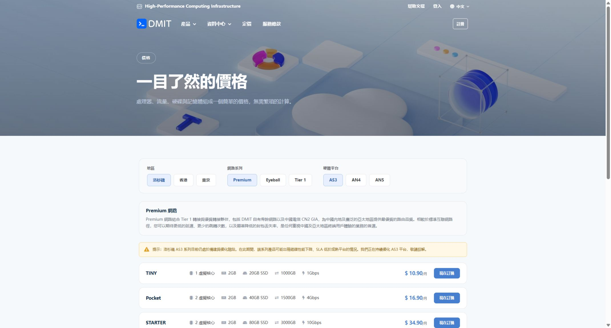

*图 1：2026-10-31 的公开定价页截图。按“地区 → 网络系列 → 硬件平台”阅读；截图价格不等于最终结账金额。*

### 搬瓦工的选购步骤

1. 从 [BandwagonHost 官网](https://bandwagonhost.com/)进入 VPS Hosting，避免误把第三方“中文网”当成商家后台。
2. 选择产品系列。下图以 E-Commerce VPS 为例，不表示它是每个人的最优选择。
3. 选择地区，再选择机房。例如下图是 Los Angeles → USCA_9。
4. **逐项读套餐自己的周期和金额。** 截图当日，即使上方选择 1 Month，入门规格仍显示最近可售周期为 3 month；不要把 89.99 美元／季度读成月价，也不要把别的机房起步价套过来。
5. 点 Order 后复查订单，自行填写真实资料并完成付款。
6. 服务开通后，从 My Services 进入对应服务，再打开 KiwiVM。操作系统、SSH 端口和登录信息以该实例为准；不要默认 SSH 一定是 22。

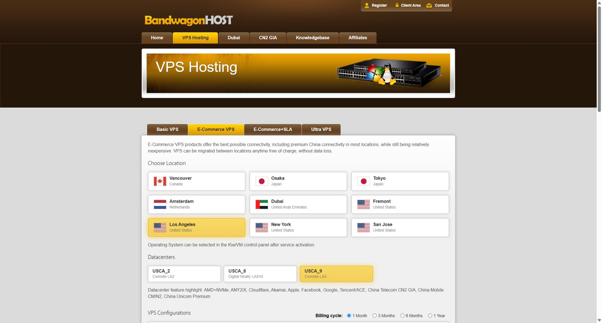

*图 2：2026-10-31 的公开选购页。先认准产品系列和机房，再向下看套餐周期。截图来自 bwh81.net 公开页面，正文入口使用 BandwagonHost 官方主域名。*

**OS Reload／重装系统会清空服务器数据。** 新买的空机器可按计划选系统；已经放过网站、文件或服务的机器，先备份再决定，不能把重装当成日常修复按钮。

本文不承诺无条件退款或免费换 IP。付款前阅读 [DMIT 退款说明](https://docs.dmit.io/guide/getting-started)中的 Refund 入口，以及 [BWG 服务条款](https://bandwagonhost.com/terms-of-service.php)。支付平台保存的自动扣款授权，也要单独检查。

<a id="client"></a>

## 三、已有节点，先把本地客户端用明白

### Windows 使用 Clash Verge Rev

1. 从项目的[官方发布页](https://github.com/clash-verge-rev/clash-verge-rev/releases)下载匹配系统架构的安装包。大多数普通 Windows 电脑使用 x64；ARM 设备要选相应版本。
2. 安装并打开，进入“订阅／Profiles”。把服务方提供的兼容订阅链接粘贴进去，点“导入”。**订阅链接通常含访问凭据，别放进公开 GitHub 仓库。**
3. 导入后选择该配置，进入“代理／Proxies”，手动选一个可用节点。先完成一次可重复的连接，不要注册过程中一直自动切换出口。
4. 选择“规则模式”。它与“系统代理”开关是两回事：前者决定如何分流，后者决定哪些程序将流量交给客户端。
5. 先开启“系统代理”，用浏览器访问一个普通 HTTPS 网站，再按第五节查出口。
6. 如果需要接管不遵守系统代理的程序，按客户端提示安装服务模式，再开启 TUN。TUN 的 DNS、IPv6、路由和排除项也要一起验证。
7. 关闭连接时，先在客户端关掉自己开启的系统代理／TUN，再退出程序。如果客户端已异常退出，在 Windows“设置 → 网络和 Internet → 代理”检查是否残留本地代理地址。

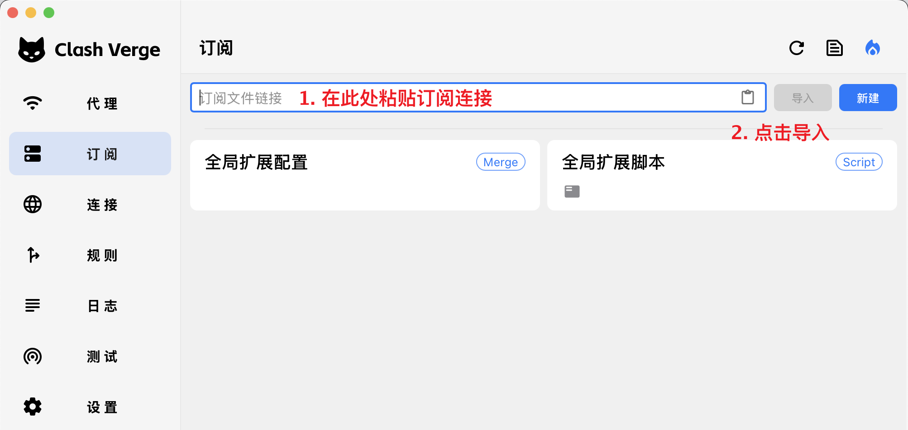

*图 3：项目官方文档配图，指向“粘贴订阅链接 → 导入”。这是文档中的示例界面，不含本文作者的真实订阅。*

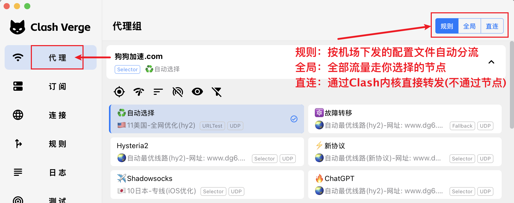

*图 4：先选配置中的代理组及节点，再确认规则模式。图里的节点仅作界面说明。*

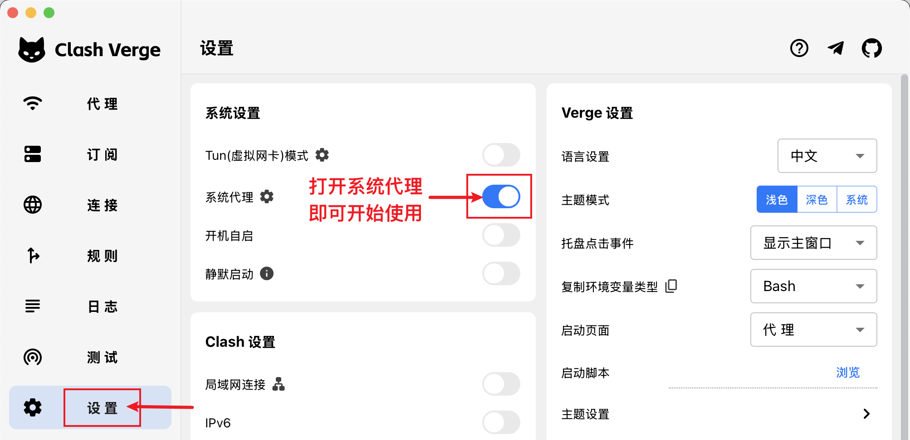

*图 5：系统代理和 TUN 是不同接管方式。名称、开关位置随版本变化，以[官方快速入门](https://www.clashverge.dev/guide/quickstart.html)为准。*

### iPhone 如何接入

先使用服务方明确支持的 iOS 客户端，从 App Store 下载并核对开发者。Shadowrocket 是社区常用选项之一，它是否在你的商店地区可售、当日价格和协议支持，要看实际商店页面；不是使用 Claude 的指定必买软件。

获得客户端后，导入服务方给的订阅／配置，选中节点，开启连接，并自行允许 iOS 添加 VPN 配置。在 Safari 内按第五节检查出口。电脑与手机需要分别验收，不能因为电脑通过就跳过手机。

如果使用 Shadowrocket，先理解当前配置的规则与全局路由；不要把 Mihomo 的 YAML 文件直接当作它的配置导入。AgentRoute 作者也明确标注其 Shadowrocket 模板尚未在实体 iPhone 上验证。

<a id="ssh"></a>

## 四、买了 VPS，怎样先跑通一条自己的连接

**本节是一条电脑浏览器的最小入门路线：Windows OpenSSH → VPS → Firefox。** 它复用服务器已有的 SSH，不需要先安装面板、开放一堆新端口或运行不明一键脚本。适合先确认服务器和线路是否可用；游戏、整机流量、手机和需要 UDP 的音视频，不在这条路线的覆盖范围里。

如果你的网络无法连接该 VPS 的 SSH，后面的隧道同样无法建立。不要把连接失败直接判断为“账号问题”。

### 1. 找齐四项资料

从服务详情确认：公网 IPv4、SSH 端口、登录用户名、认证方式。DMIT 可能需要下载或导入密钥，参见[官方 SSH 密钥说明](https://docs.dmit.io/guide/instance/get-ssh-keys)和[连接说明](https://docs.dmit.io/guide/instance/connect)。私钥不是公钥，不要传给别人。

### 2. 在 Windows 检查 SSH 客户端

打开 PowerShell，运行：

```powershell
ssh -V
```

能看到版本号即可。若提示找不到命令，从 Windows“可选功能”安装 **OpenSSH 客户端**，或由管理员按[微软说明](https://learn.microsoft.com/en-us/windows-server/administration/openssh/openssh_install_firstuse)处理。本机只需要客户端，不必为这件事安装 OpenSSH 服务器。

### 3. 建立仅监听本机的 SOCKS 隧道

下面全部是占位示例。`203.0.113.10` 是文档示例地址，不能实际连接；端口 22、用户 root 和私钥路径都要换成你的实例信息。

密钥登录示例：

```powershell
ssh -N -D 127.0.0.1:1080 -o ExitOnForwardFailure=yes -o ServerAliveInterval=30 -o ServerAliveCountMax=3 -p 22 -i "C:\YOUR_PRIVATE_FOLDER\vps-key" root@203.0.113.10
```

如果服务商给的是密码登录，移除 `-i` 和后面的私钥路径，按终端提示输入密码。终端输入密码时不显示字符是正常现象；不要把密码拼进命令行。

第一次连接时，将 SSH 主机指纹与服务商控制台或其可信控制台中取得的指纹核对，再接受。遇到“主机指纹已改变”，先查是不是重装过服务器或 IP 被重新分配，不要直接删除警告。

认证成功后，窗口可能停在那里没有新输出，这正是 `-N` 的正常行为。**保持这个窗口打开**；`-D 127.0.0.1:1080` 会创建只供本机使用的 SOCKS 入口。参数含义见 [OpenSSH 手册](https://man.openbsd.org/ssh.1)。

### 4. 让 Firefox 明确使用它

打开 [Firefox 官方下载页](https://www.firefox.com/)，安装后进入“设置”，搜索“代理／proxy”。不同版本入口可能在“网络设置”或“隐私与安全 → 高级设置”中，打开连接设置，填写：

| 字段 | 填写内容 |
| --- | --- |
| 方式 | 手动代理配置 |
| SOCKS 主机 | `127.0.0.1` |
| 端口 | `1080` |
| SOCKS 版本 | SOCKS v5 |
| 使用 SOCKS v5 时代理 DNS／Proxy DNS when using SOCKS v5 | 勾选 |
| HTTP／HTTPS 代理栏 | 此路线留空，不要把 SOCKS 端口误填为 HTTP 代理 |

参见 [Mozilla 连接设置](https://support.mozilla.org/en-US/kb/connection-settings-firefox)。如果浏览器另设了独立 DoH，先确认它与远端 DNS 的预期路径一致，并用第五节检测；勾选一个选项不能代替实际验收。

现在在**这个 Firefox**里访问 IP 检测页，公网出口应与 VPS 出口对应。其他浏览器、桌面 App 和命令行不会因此自动使用它。

另开一个 PowerShell，可用下面的显式代理请求做交叉检查：

```powershell
curl.exe --max-time 15 --proxy socks5h://127.0.0.1:1080 https://api.ipify.org
```

`socks5h` 表示这个请求将目标域名交给代理端解析。若浏览器与此命令结果不同，先检查浏览器配置和所用检测目标；不要急着重买服务器。

### 5. 停用与恢复

在 Firefox 将代理方式改回原来的设置，再到 SSH 窗口按 `Ctrl+C` 结束隧道。此方法不更改服务器防火墙、DNS 或系统路由，也不让本机 1080 端口向局域网开放。

SSH 的动态代理不承载 UDP，也不自动约束 WebRTC。它的作用范围到这里为止。如果你需要长期整机 VPN，可继续参考 [WireGuard 官方安装说明](https://www.wireguard.com/install/)和 [Ubuntu 默认网关配置](https://ubuntu.com/server/docs/wireguard-vpn-defaultgw/)建立专门方案；不要在同一台电脑同时叠开多个 TUN／VPN 来碰运气。

<a id="check"></a>

## 五、不要只看“美国 IP”，按顺序检查四件事

[逸尘 10 月 31 日帖子](https://x.com/gengdaJ/status/2116397558545453168)提到 IPPure 与 WebRTC 排查。这是很有用的排错入口；帖子也只描述了较短时间的账号观察，不能据此认定 WebRTC 是某次封号的唯一原因。

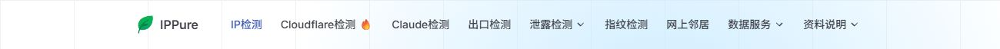

*图 6：点击对应检测工具，不要把首页的服务介绍或分数当成设备已经通过检查。截图不展示本人的 IP 检测结果。*

### 按这张表验收

在实际准备使用 Claude 的浏览器和设备上操作。保持你正在使用的连接，先记录预期出口；不必为了取基线关闭现有代理。

| 检查项 | 去哪里看 | 怎样理解结果 |
| --- | --- | --- |
| 网页出口 | [IPinfo](https://ipinfo.io/)、[IPPure](https://ippure.com/) | 记录实际公网 IP、ASN／运营商、地区；地区数据库可能有偏差 |
| IPv4 和 IPv6 | [BrowserLeaks IP](https://browserleaks.com/ip) | 两种地址分别检查；IPv4 已代理不能证明 IPv6 已接管 |
| DNS | [IPPure DNS 检测](https://ippure.com/DNS-Leak-Detect) | 对照预期解析器与分流策略，不能只按解析器显示在哪个国家判定 |
| WebRTC | [IPPure WebRTC 检测](https://ippure.com/Browser-WebRTC-Leak-Detect)、[BrowserLeaks WebRTC](https://browserleaks.com/webrtc) | 是否出现预期之外的公网出口；私网地址、mDNS 名称或空结果需要分别解释 |

测试网站本身也会看到连接信息，检查时无需给它们提交 Claude 密码、Cookie 或订阅链接。

### 检测不对，先修对应的一层

**网页出口不对**：检查客户端是否启用、选了哪个配置、检测站点命中了 DIRECT 还是代理。规则模式允许部分网站直连，因此两个检测站点出口不同，先看命中规则，别直接宣布“漏了”。

**DNS 不对**：检查浏览器自己的安全 DNS、客户端 DNS 覆写和备用解析器。DoH 只是加密方式，不证明查询经过了代理。需要把解析器连接本身的路由也对齐。

**WebRTC 出现预期之外的公网 IP**：优先检查 UDP 与 IPv6 的接管。桌面 Chrome／兼容 Chromium 可在官方商店核对 [Google 的 WebRTC Network Limiter](https://chromewebstore.google.com/detail/webrtc-network-limiter/npeicpdbkakmehahjeeohfdhnlpdklia)，在其选项中选择 `Disable non-proxied UDP`，然后重新检测并检查会议、通话是否正常。Firefox 和手机不能照抄这个扩展方法。

**页面没有候选或检测区空白**：记录为未确认。脚本、权限、拦截扩展、STUN 不可达都可能影响显示。WebRTC 的技术边界可参见 [RFC 8828](https://www.rfc-editor.org/rfc/rfc8828.html)。

第三方“风险分”“纯净度”只是一项辅助信号。本文没有找到 Anthropic 公布的“低于多少分就能注册”阈值；因此不会建议你为追逐一个分数不断换 IP。

### AgentRoute 怎么接，不把原配置弄坏

[AgentRoute](https://github.com/ryuu-restart/agent-route)是分流规则和接入说明，**不提供服务器、节点或会员**。它的价值是把规则、DNS 和回退过程整理在一起。

先备份原配置，再按[客户端接入文档](https://github.com/ryuu-restart/agent-route/blob/master/docs/CLIENTS.md)选模板。Clash Verge Rev 的规则可放“编辑规则”的前置规则；DNS 与嗅探按扩展配置／脚本处理。已有订阅不要直接整份覆盖，节点地址必须保留正确的直连路径，防止递归连接。

如果让 AI 协助，可以给它以下任务，但不要把真实订阅链接贴到公开讨论中：

> 先只读检查我的客户端、内核版本、当前配置来源和接管方式。按 AgentRoute 的 CLIENTS 与 DNS-WEBRTC 文档制定适配方案，先备份并保留现有节点、代理组、局域网例外和当前选择。修改放在订阅刷新后仍能保留的位置。先检查配置，再重载，验证网页出口、DNS、IPv6、WebRTC 和音视频。最后刷新一次订阅，确认配置仍在，并报告回退方法与未验证项目。不要为了测试而中断当前连接。

规则末尾不回落 DIRECT，与“客户端整个退出后也不会直连”是两种不同保证。需要断线保护时，应检查具体客户端的防火墙／阻断机制，并在独立、可恢复的环境测试。

按 [DNS 与 WebRTC 文档](https://github.com/ryuu-restart/agent-route/blob/master/docs/DNS-WEBRTC.md)的公开验证基线，其实体手机、真实 TUN 和持续泄露测试覆盖有限；接入模板后仍要自己验收，不能直接引用作者的配置检查当作本机测试结果。

<a id="mail"></a>

## 六、准备一个自己能找回的 Proton 邮箱

推荐 [Proton Mail](https://proton.me/)的理由很实际：有免费方案，也提供邮件追踪防护。它不是 Claude 指定邮箱，更不承诺提升所谓“账号权重”。已有长期可用邮箱，也可以先使用。

1. 打开 [Proton 注册入口](https://account.proton.me/signup)，选择 Free。
2. 设置用户名和独立密码，确认你创建的是可以收信的 Proton Mail 地址。
3. 自行完成页面出现的人机验证。是否要求额外验证以实际页面为准，不能保证“永远免手机号”。
4. 保存 Recovery Kit／恢复短语，添加并验证由自己控制的恢复邮箱；恢复邮箱与恢复数据的能力不同，按[官方恢复说明](https://proton.me/support/set-account-recovery-methods)检查。
5. 进入 Mail，先收发一封普通测试邮件，确认自己能持续访问，再拿它注册重要账号。

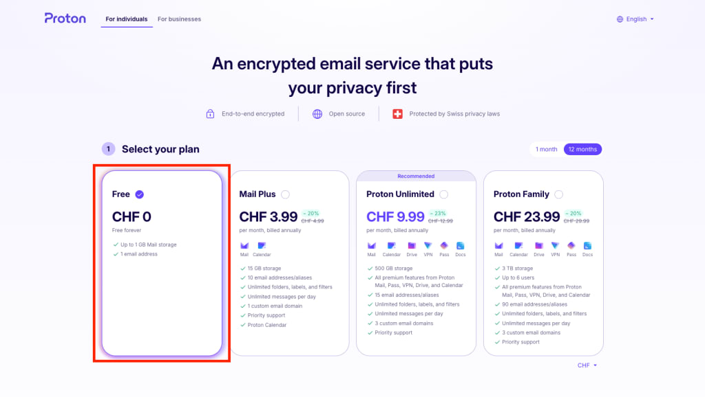

*图 7：选择免费套餐即可开始。来自 [Proton 官方注册图解](https://proton.me/support/create-a-free-email-account-address)。*

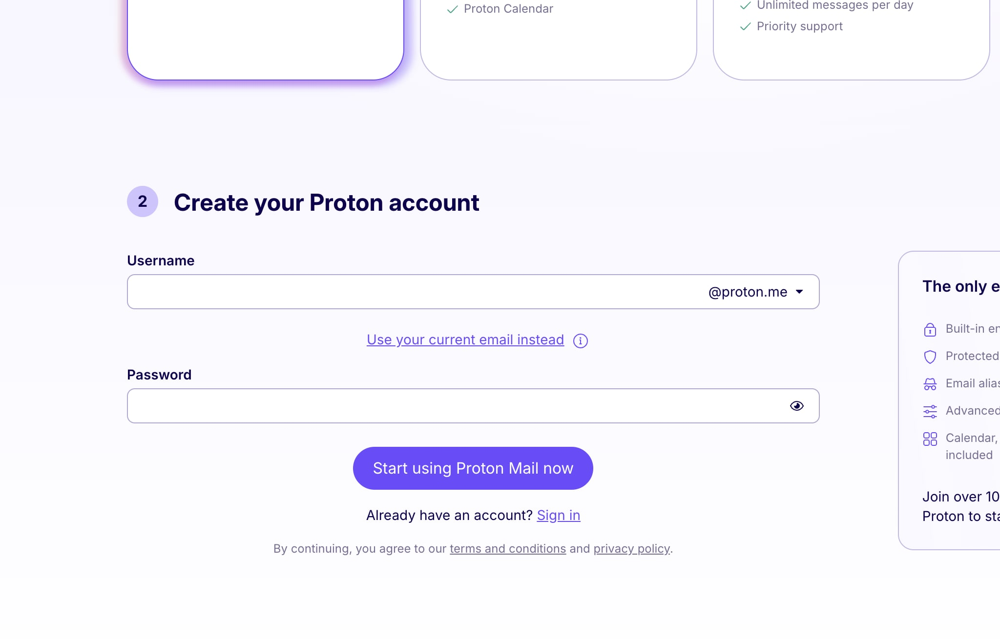

*图 8：保存完整邮箱地址和密码；恢复资料另行保管，不要截图上传公开仓库。*

Proton 的[邮件追踪防护](https://proton.me/support/email-tracker-protection)可以阻挡已知追踪器，但不会让你点击后的任意网站访问都匿名。登录验证邮件尽量在发起流程的同一个浏览器环境处理；如果页面给的是跨设备验证码，就回到最初发起登录的设备填写。

收不到 Claude 邮件时，先确认地址拼写、垃圾邮件、收信是否正常、是否请求了新链接。社区有“补充恢复邮箱后恢复收信”的反馈，但它不是适用于所有收信失败的保证。

<a id="apple"></a>

## 七、美区 Apple 账户怎么准备

**只有网页订阅时，不需要 Apple 账户。** 选择 iPhone 内购路线时，才需要下载 App、管理 App Store 付款与订阅的账户。

“Apple ID”现在叫“Apple 账户”。美区指账户的国家或地区设置，并不代表购买一个美国身份。以下路径适用于具备对应地区资料与使用条件的人；姓名、生日、手机号和账单资料按真实情况填写。

### 按 10 月 24 日原帖，从创建入口开始

[蔚蓝 10 月 24 日注册教程](https://x.com/zureA255062/status/2114016362561466717)给出的路线是：iPhone Safari 打开 iCloud.com → 页面“Sign In” → “Create Apple Account”。这里的“Sign In”用来找到创建入口，接下来进入的是创建账户页面。

作者报告使用日常直连网络、自己的 `+86` 手机号完成创建。这可以作为 Apple 注册报错时的经验线索，但原帖的“99% 成功”“开代理必封”“终身稳定”不是 Apple 公布的结论，也不能套用到 Claude 的注册条件。

1. 按上述原帖从 [iCloud.com](https://www.icloud.com/)寻找“Create Apple Account”，也可以打开 [Apple 账户官网](https://account.apple.com/)选“创建你的 Apple 账户”；设备入口见[官方创建说明](https://support.apple.com/zh-cn/108647)。
2. 填写姓名、真实生日、未用于该账户的邮箱、密码和长期能接收验证信息的手机号。
3. 根据你的实际情况设置国家或地区；需要美国商店时确认对应条件与付款信息。手机号区号和商店地区是不同字段，按自己实际号码选择，不要把号码硬改成 `+1`。
4. 自行完成邮箱与短信验证，并检查账户恢复方式。
5. 需要使用该账户下载 App 时，从 App Store 的头像入口检查当前商店账户。若需切换，只处理媒体购买用途的登录，不必为了下载 App 退出主 iCloud 账户。

首次进入商店下载免费 App 时，如果出现“This Apple Account has not yet been used in the iTunes Store”，按页面选择 Review／检查，阅读条款，核对商店地区，并完成要求的付款及账单信息。能创建 Apple 账户与能在 App Store 购买，是两个需要分别确认的阶段。

如果创建时提示“此时无法创建你的账户”，先按 [Apple 官方排查](https://support.apple.com/zh-cn/120636)检查系统、网络和服务状态。需要换网络测试时，由你在自己的设备上决定，先保存正在进行的工作；不要一上来清空整个 Safari 历史与网站数据。

### “付款方式选无”不是固定步骤

Apple 的部分创建流程提供“无”，它是否出现取决于地区、入口和账户状态。**看不到“无”时，不要随意填写他人信用卡或生成一个账单地址。** 已有余额、未结束订阅、家庭共享和待处理订单，也可能影响改区。

已有账户更改地区的常见路径是“设置 → 姓名 → 媒体与购买项目 → 国家／地区”，以当前系统界面为准。改之前先读[官方准备事项](https://support.apple.com/zh-cn/118283)，尤其是余额、订阅和 iCloud 数据处理。

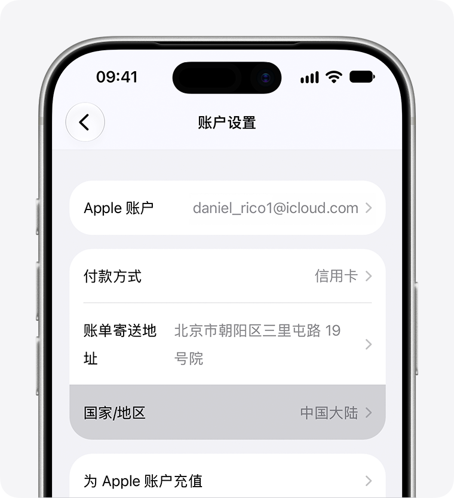

*图 9：Apple 官方系统界面示例，用来识别“国家／地区”入口。这不是注册成功截图；系统版本不同，菜单层级可能不同。*

不要把买来的共享账号登录到系统级 iCloud。账户控制权涉及查找、激活锁和资料恢复；最省后续麻烦的做法，是始终使用自己能证明归属的账号。

<a id="claude"></a>

## 八、注册 Claude，先完成免费使用

确认第一节的地区与手机号条件之后，按下面顺序自行操作：

1. 在准备好的浏览器中打开 [claude.ai](https://claude.ai/)。核对域名，不要在仿冒站输入邮箱验证码。
2. 用自己的邮箱选择 `Continue with email`，或使用页面实际提供的其他官方登录方式。
3. 回邮箱打开最新登录邮件，按提示完成验证。登录链接和验证码都相当于临时凭据，不要发给别人。
4. 如果出现手机验证，使用自己长期控制、符合[官方要求](https://support.claude.com/en/articles/8287232-verify-your-phone-number)的号码完成短信验证。官方文档不接受 VoIP、Google Voice、App 生成号码或无法收短信的号码，不保证购买的接码号码可用。
5. 阅读条款并自行确认，完成页面要求的资料。先选择免费使用，发一条普通问题并确认回复正常。
6. 在账户设置里确认登录邮箱；手机随后登录时使用同一个 Claude 账号。

**完成标准：你能收取登录邮件、进入自己的 Claude 账号并完成一轮对话。** 能打开官网首页不等于注册成功；收到验证码也不等于账号可长期使用。

若出现身份核验，按官方页面要求用自己的资料完成，或向官方支持说明问题。不要把重新注册、借用身份或清空本机历史当成常规解决步骤。

### 把近期经验放回它适用的位置

这次重点阅读了 [夙愿学长的 9 月 23 日长文及 10 月更新](https://x.com/suyuan1711/status/2102744129235193975)、[余温 10 月 25 日更新的基础设施文章](https://x.com/gkxspace/status/2101993381303820704)和[蔚蓝的苹果内购教程](https://x.com/zureA255062/status/2103672988524855361)。它们提供了网络、邮箱、付款和续费的实操线索，但不同作者的结论并不完全一致。

| 社区常见说法 | 本文的处理方式 |
| --- | --- |
| 注册必须先买某一种住宅 IP | 可比较独立出口的可控性，不把付费购买某类 IP 列成官方必要条件 |
| 必须指定某个浏览器内核版本 | 没有官方依据证明通用有效，不推荐回退到旧版浏览器 |
| 只有某个邮箱能注册 | 按官方当前登录入口操作，邮箱重点是长期控制与收信正常 |
| 改时区、语言、删设备记录就能防封 | 不当成保证；不让小白为此删除会话、凭据或改系统设置 |
| 先用几天 Pro 再升级，保证不封 | 先试用有利于控制花费，等待天数不能保证风控结果 |
| 某张卡此前必过 | 付款接受情况会变，不能照抄旧帖。夙愿原文已有 10 月 19 日撤回部分卡推荐的更新 |

<a id="subscribe"></a>

## 九、购买 Claude 会员，两条路线选一条

### 先看清套餐、周期和币种

截至核对日，[官网定价](https://claude.com/pricing)显示：Pro 月付 20 美元；年付一次收 200 美元，页面以约 17 美元／月展示。当前高档个人套餐显示 Max 100 美元／月、Ultra 200 美元／月。价格未含适用税费，地区、渠道与最终结账金额可能不同。

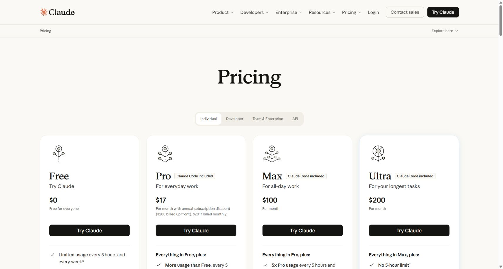

*图 10：2026-10-31 官网截图。Pro 卡片上的 17 美元是年付折算价，不能理解成月付只扣 17 美元；旧帖中的 Max 20x 名称也不宜直接套用当前页面。*

我的建议是先按月确认自己的使用量。付费会员仍有用量规则；Pro 也不是可以随意调用 API 的充值余额。

### 路线 A：在 Claude 网页付款

适合已经有受支持付款方式的人，无需 Apple 账户。

1. 登录自己的免费 Claude 账号，打开头像／姓名菜单。
2. 进入 `Settings → Billing → Upgrade plan`，选择 Pro。
3. 明确选择 Monthly 或 Annual，核对本次实际扣款总额。
4. 填写自己付款方式的真实账单信息，完成银行需要的 3DS 验证后，自行确认订阅。
5. 保存收据，回 Billing 确认套餐、周期和下次账单日期。

入口依据：[官方 Pro 订阅步骤](https://support.claude.com/en/articles/8325609-how-do-i-sign-up-for-the-pro-plan)。网页银行卡支付要检查发卡与账单地区是否受支持，地址需与银行记录一致；官方说明网页不接受 PayPal、Venmo，详见[拒付排查](https://support.claude.com/en/articles/9402418-why-was-my-card-declined)。这不等于 Apple 商店所有地区的支付规则也相同。

### 路线 B：iPhone 内购与 Apple 账户余额

适合已有合适 Apple 账户、能在对应商店购买的人。网页付款与 iOS 内购二选一，不要为了排错在两个渠道各买一次。

这条操作顺序主要汇总自 X：蔚蓝的[礼品卡与内购长文](https://x.com/zureA255062/status/2103672988524855361)强调自己掌握账号、礼卡兑换后在 App 内购买、按需取消续费；夙愿的[订阅章节](https://x.com/suyuan1711/status/2102744129235193975)提供了支付宝礼卡入口与购买失败后的处理经历；蔚蓝的[10 月 24 日新帖](https://x.com/zureA255062/status/2114016362561466717)补充了 Apple 账户创建和首次商店检查。下面保留可核对的步骤，不采用“必过、必退、永久稳定”的措辞。

**第一步，先确认 App 和账号。** 在 App Store 下载官方 Claude，开发者核对 Anthropic。打开 App，用前面同一个 Claude 账号登录，确认免费功能正常。然后检查 App Store 当前使用的 Apple 账户和商店地区。

**第二步，再决定是否买礼品卡。** Apple 账户余额可用于部分 App 内订阅，但有些购买仍要求登记有效付款方式；余额不是万能的拒付解决办法，见 [Apple 余额用途](https://support.apple.com/en-la/118245)。

购买礼品卡可按以下顺序考虑：

| 渠道 | 如何操作 | 下单前看什么 |
| --- | --- | --- |
| [Apple 美国官网](https://www.apple.com/shop/gift-cards) | Buy → 选择电子邮件交付及金额 → 填自己的收件邮箱 → 按结账页付款 | 商店地区、交付方式、收件邮箱、是否接受你的卡及真实账单资料 |
| 有正规订单和售后的零售渠道 | 搜索美国地区 Apple Gift Card，确认商品后购买 | 标注 US、用途、手续费、发货时间、退款条件和收据 |
| 社区提到的支付宝礼卡入口 | 夙愿与蔚蓝帖子描述过境外城市／礼卡入口，夙愿提到 Pockyt Shop | 这里只保留为社区线索；本次未验证入口、库存和售后，不能保证现仍可买 |

如果要对照 X 帖找支付宝入口，夙愿文中的路径是：首页城市入口 → 国际／港澳台 → 北美洲 → 美国城市（示例旧金山）→ 超值抢购／折扣礼卡 → Pockyt Shop → 地区选美国 → 核对 Apple Gift Card US 或 App Store & iTunes USA → 查看总价与费用 → 购买后从订单取卡。入口名称和商品会变化，找不到时不要把名称相似的小店当成同一渠道；按原帖图片逐项核对。作者还提到 SEAGM 作为缺货时的备选，但本教程没有验证其当前费用、库存或服务质量。

美区账户要匹配美区可兑换的卡，不要只看都是美元。拿到兑换码后只在 Apple 官方页面或 App Store 使用，不给代充商登录你的账号。

**第三步，兑换到正确账户。** 打开 App Store → 头像 → 核对账户 → “兑换充值卡或代码” → 手动输入代码 → 兑换。回账户页确认余额。步骤见 [Apple 官方兑换说明](https://support.apple.com/zh-cn/118242?device-type=iphone)。

金额根据 App 内当日方案及税费计算，别照抄帖子中的 20 美元或 250 美元整额。先确认能购买所需项目，再考虑小额按需充值；不要为测试一次充值很大金额。

**第四步，在 Claude App 升级。** 点头像／姓名进入设置，找 `Upgrade to Pro`，选择需要的周期，检查 Apple 原生付款确认框上的商品、金额、币种、续费条款与付款账户，再自行确认。官方路径见 [iOS Pro 订阅说明](https://support.claude.com/en/articles/9266495-how-do-i-sign-up-for-claude-pro-on-the-claude-app-for-ios)。

**第五步，确认权益到账。** 在 Claude 设置确认已显示付费套餐，在 Apple 订阅中确认商品与续费日期，并保存收据。被扣款但没升级，先排查是否登录了另一个 Claude 账号，再通过 App 提供的恢复购买入口或官方支持处理，别再次付款。

### 不想自动续费，购买后就处理

网页购买：回 `Settings → Billing → Cancel`。

iOS 内购：在 Claude 的 Billing 里进入 `Manage subscription`，或通过 Apple 的订阅管理找到 Claude 后取消；如果看不到，按收据确认是哪个 Apple 账户购买的。

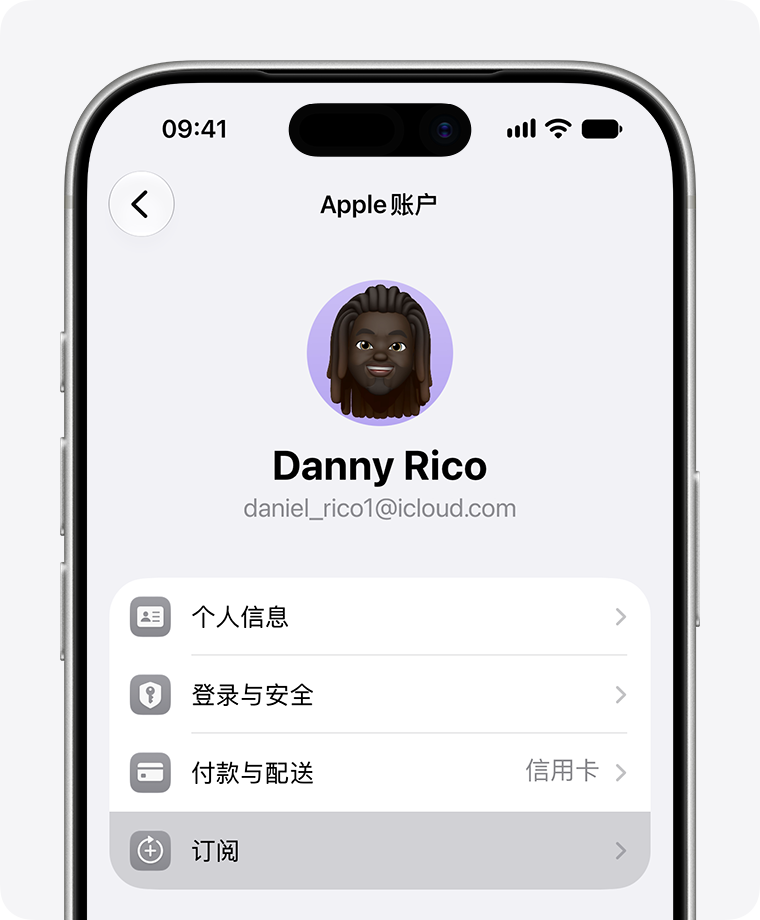

*图 11：Apple 官方示例图。管理的是购买收据所对应账户下的订阅，不要误把另一个账户的空列表理解成已经取消。*

Claude 官方说明取消后通常仍可使用至本账期结束，并要求至少在下次账单日前 24 小时取消以避免续扣；参见[取消订阅](https://support.claude.com/en/articles/8325617-cancel-your-pro-max-or-ultra-subscription)与 [Apple 取消说明](https://support.apple.com/zh-cn/118428)。删除 App 不会取消会员。

退款申请与取消续费也是两件事。苹果内购不等于必退，社区个案不能替代 Apple 对具体订单的审核。

<a id="trouble"></a>

## 十、遇到问题，先定位到具体一步

| 现象 | 先做什么 | 别急着做什么 |
| --- | --- | --- |
| 节点一直超时 | 检查订阅有效期、配置是否激活、节点可达性和日志 | 重装电脑、购买第二台 VPS |
| 只有浏览器能用 | 检查程序是否遵守系统代理；需要时验证 TUN | 认为整机已经代理 |
| SSH 失败 | 核对实例 IP、端口、用户、密钥、实例状态和服务商控制台 | 忽略主机指纹变化 |
| SSH 窗口没输出 | 检查本地 1080 监听及显式代理请求，`-N` 本来就不进入远程 shell | 仅凭无输出就重装服务器 |
| 检测站显示不同 IP | 对照各域名的规则、IPv4／IPv6、实际节点 | 用一个检测分数判断封号原因 |
| Proton 收不到信 | 检查收件地址、垃圾邮件、普通邮件是否能收、最新验证请求 | 连续注册很多邮箱 |
| Apple 无法创建账户 | 按官方方法检查系统、网络和服务状态，必要时找支持 | 买共享账号或修改虚假出生日期 |
| Apple 无法完成购买 | 核对账户、余额含税、未结账单、App 内购买限制，再联系支持 | 不断点击购买或重复充值 |
| Claude 银行卡被拒 | 核对支持的发卡与账单地区、真实地址、额度和 3DS，联系发卡行 | 生成一个“免税州地址”硬填 |
| Claude 出现地区／身份核验提示 | 核对官方条件，用自己的资料或联系官方支持 | 借用身份、购买过审账号 |
| 扣款后套餐没变 | 核对 Claude 邮箱、Apple 账户与收据，使用恢复购买／支持渠道 | 两个平台再各买一次 |

联系 Apple 支持时，可以据实描述：

> 我的 Apple 账户余额足够，正在购买 Claude 的 App 内订阅，但提示“无法完成购买”。我已经核对了账户、金额和 App 内购买限制。请帮我检查是否存在未处理账单或购买限制，并告知下一步。

不用编造居住地址或消费经历，也不用要求客服承诺“72 小时一定解除”。处理时间与结果由实际审核决定。

当你可以解释自己用的是什么线路、哪个程序经过代理、邮箱如何找回、谁在收会员费、从哪里取消续费，这套环境才算真正归自己掌握。

<a id="references"></a>

## 参考链接与资料日期

### 近期社区经验

1. [夙愿学长：Claude 注册、网络与订阅长文](https://x.com/suyuan1711/status/2102744129235193975)：原帖 2026-09-23，标题标注 10 月更新；原文含 10 月 19 日银行卡推荐变更。用于提炼操作线索，防封与风控因果未获独立验证。
2. [逸尘：IPPure、WebRTC 与规则工具](https://x.com/gengdaJ/status/2116397558545453168)：2026-10-31。该帖中的观察期较短，不足以证明长期稳定性。
3. [余温：海外基础设施经验](https://x.com/gkxspace/status/2101993381303820704)：原帖 2026-09-21，正文标注更新到 2026-10-25。原帖含推广链接；本教程商家入口不带邀请码。
4. [蔚蓝 WEILANX：Apple 账户、礼卡与 App 内订阅经验](https://x.com/zureA255062/status/2103672988524855361)：2026 年 9 月帖。用于了解内购操作与常见问题，不将作者成功次数、退款经验当作承诺。
5. [蔚蓝 WEILANX：美区 Apple 账户手机注册教程](https://x.com/zureA255062/status/2114016362561466717)：2026-10-24。用于补充 iCloud.com 创建入口、手机号字段与首次商店 Review；成功率、长期稳定性和退款保证未获证实。

### 网络、客户端与服务器原始资料

6. [AgentRoute 项目](https://github.com/ryuu-restart/agent-route)、[客户端适配](https://github.com/ryuu-restart/agent-route/blob/master/docs/CLIENTS.md)、[DNS 与 WebRTC 指南](https://github.com/ryuu-restart/agent-route/blob/master/docs/DNS-WEBRTC.md)。指南核对日期 2026-10-31；验证范围见原文。
7. [Clash Verge Rev 发布页](https://github.com/clash-verge-rev/clash-verge-rev/releases)、[快速入门](https://www.clashverge.dev/guide/quickstart.html)、[自定义规则](https://www.clashverge.dev/guide/rules.html)、[扩展合并说明](https://www.clashverge.dev/guide/extend.html)。
8. [DMIT 官网](https://www.dmit.io/)、[定价](https://www.dmit.io/pages/pricing)、[帮助中心](https://docs.dmit.io/)、[SSH 密钥](https://docs.dmit.io/guide/instance/get-ssh-keys)、[SSH 连接](https://docs.dmit.io/guide/instance/connect)。
9. [BandwagonHost 官网](https://bandwagonhost.com/)、[套餐入口](https://bandwagonhost.com/vps-hosting.php)、[服务条款](https://bandwagonhost.com/terms-of-service.php)。
10. [OpenSSH ssh 手册](https://man.openbsd.org/ssh.1)、[Windows OpenSSH](https://learn.microsoft.com/en-us/windows-server/administration/openssh/openssh_install_firstuse)、[Firefox 连接设置](https://support.mozilla.org/en-US/kb/connection-settings-firefox)。
11. [Google WebRTC Network Limiter](https://chromewebstore.google.com/detail/webrtc-network-limiter/npeicpdbkakmehahjeeohfdhnlpdklia)、[WebRTC IP 处理标准 RFC 8828](https://www.rfc-editor.org/rfc/rfc8828.html)。
12. 检测工具：[IPPure](https://ippure.com/)、[IPinfo](https://ipinfo.io/)、[BrowserLeaks IP](https://browserleaks.com/ip)、[BrowserLeaks WebRTC](https://browserleaks.com/webrtc)。它们是第三方工具，不是 Anthropic 的审核系统。
13. 进阶 VPN：[WireGuard 官方](https://www.wireguard.com/install/)、[Ubuntu VPN 默认网关](https://ubuntu.com/server/docs/wireguard-vpn-defaultgw/)。

### 邮箱、Apple 与 Claude 官方说明

14. [Proton 免费邮箱注册](https://proton.me/support/create-a-free-email-account-address)、[账户恢复](https://proton.me/support/set-account-recovery-methods)、[邮件追踪防护](https://proton.me/support/email-tracker-protection)。
15. [Apple 创建账户](https://support.apple.com/zh-cn/108647)、[无法创建账户](https://support.apple.com/zh-cn/120636)、[更改地区](https://support.apple.com/zh-cn/118283)。本次读到的 Apple 创建／改区资料含 2026 年 9 至 10 月更新。
16. [Apple 美国礼品卡](https://www.apple.com/shop/gift-cards)、[兑换礼品卡](https://support.apple.com/zh-cn/118242?device-type=iphone)、[账户余额可买什么](https://support.apple.com/en-la/118245)、[取消订阅](https://support.apple.com/zh-cn/118428)。
17. [Claude 支持地区](https://support.claude.com/en/articles/8461763-where-can-i-access-claude)、[手机号验证](https://support.claude.com/en/articles/8287232-verify-your-phone-number)。手机号文章为 2026 年 8 月更新。
18. [Claude 当前定价](https://claude.com/pricing)、[网页 Pro 订阅](https://support.claude.com/en/articles/8325609-how-do-i-sign-up-for-the-pro-plan)、[iOS Pro 订阅](https://support.claude.com/en/articles/9266495-how-do-i-sign-up-for-claude-pro-on-the-claude-app-for-ios)、[银行卡被拒](https://support.claude.com/en/articles/9402418-why-was-my-card-declined)、[取消会员](https://support.claude.com/en/articles/8325617-cancel-your-pro-max-or-ultra-subscription)。

资料日期说明：近期社区经历优先选近三个月；SSH、浏览器、DNS 等基础说明优先引用仍在维护的原始文档，不为了“新”而引用转载文章。旧版套餐对比资料与当前官网冲突时，价格和套餐以当前官网及实际结账页为准。检索中出现一份标注 2026-11-12 生效的地区政策，晚于本稿日期，未将它当作当日已生效规则使用。

## 图片来源与验证范围

全部配图均为真实网页截图或官方公开帮助配图，没有生成仿真的付款成功图。图 1、2、6、10 为 2026-10-31 公开页面截图；图 3—5 来自 Clash Verge Rev 官方图解；图 7—8 来自 Proton 官方图解；图 9、11 来自 Apple 官方帮助。逐图来源及图片文件链接见 [assets/README.md](assets/README.md)。

本文未执行账号登录、注册提交、购买或订阅，也未实际购买 VPS 或完成手机端操作；SSH 方案依据原始手册编写，未在新购远端实例上做端到端测试。页面入口和金额随版本、地区、账户状态变化，需在自己的界面确认。公开仓库不包含私人 IP、真实节点、密钥、验证码或付款资料。
