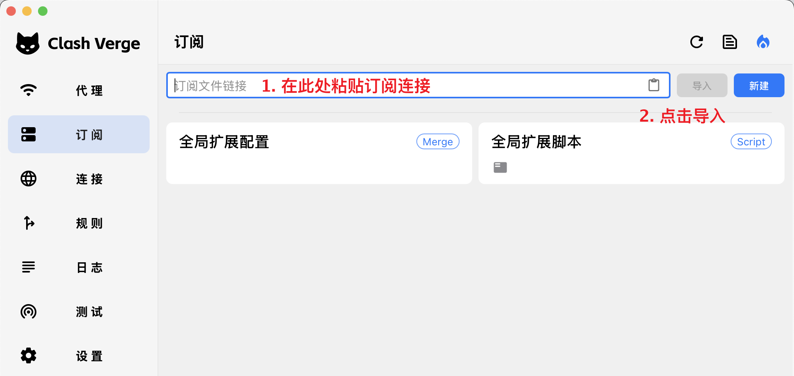
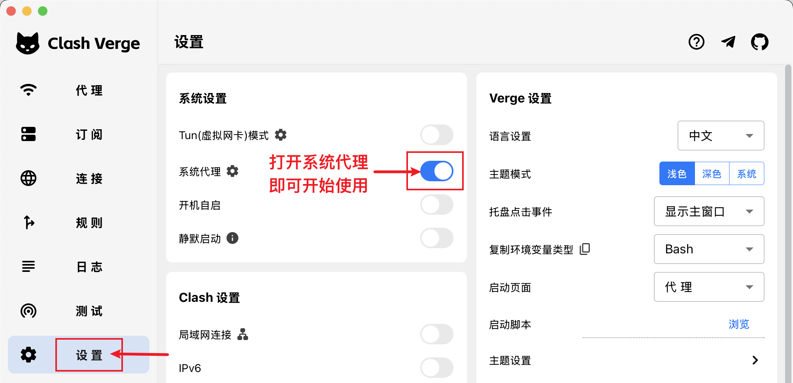

# VPS 购买后如何搭建自己的代理节点

从 DMIT／搬瓦工服务开通，到 Windows 和 iPhone 接入的一条完整路线：**Xray + VLESS REALITY + XTLS Vision**。

[返回总教程](README.md) · [HTML 阅读版](vps-setup.html)

资料核对日期：2026-10-31。本文命令以全新的 **Ubuntu 24.04 LTS 或 Debian 12、systemd、公网 IPv4** 机器为前提，核心版本固定为 [Xray 26.10.29](https://github.com/XTLS/Xray-core/releases/tag/v26.10.29)。现有服务器已有网站、面板或代理时，不要直接覆盖配置。

这次补上的，是服务器端真正部署节点的步骤。总教程中的 SSH 动态代理只供浏览器临时接入，不能替代本篇流程。

## 先看懂最终连线

| 位置 | 装什么／做什么 |
| --- | --- |
| 海外 VPS | Xray 服务端，监听 TCP 443 |
| Windows | Clash Verge Rev，导入本地节点配置 |
| iPhone | 支持 VLESS REALITY Vision 的客户端，填写同组连接参数 |
| 访问的网站 | 看到 VPS 的公网出口；具体访问仍取决于线路和目标服务规则 |

这条路线不要求你先购买域名、签发自己的 TLS 证书或安装网页管理面板。REALITY 的目标域名是传输配置的一部分，不是让你把该域名的 DNS 改到自己的 VPS。

**本篇只提供操作说明和占位模板，未连接你的 VPS、安装远端服务或修改网络设置。** 文末区分配置检查与尚未实测的部分。

## 1. 在 Windows 连上服务器

从服务商控制台找齐：公网 IP、SSH 端口、登录用户、密钥或密码。DMIT 的密钥获取方式见[官方说明](https://docs.dmit.io/guide/instance/get-ssh-keys)。

打开 PowerShell，检查：

```powershell
ssh -V
```

下面的 `203.0.113.10` 是无法实际使用的文档示例地址。将 IP、端口、用户名和密钥路径全部换成自己的：

```powershell
ssh -p 22 -i "C:\YOUR_PRIVATE_FOLDER\vps-key" root@203.0.113.10
```

使用密码认证时，去掉 `-i` 与私钥路径，按提示输入密码。第一次连接要从服务商可信控制台核对主机指纹，再接受；不要跳过指纹检查。

登录后，下面的命令都在 **VPS 的 Linux 终端**执行，不是在本机 PowerShell 执行。需要 root 权限；若登录用户不是 root，先运行：

```bash
sudo -i
```

先做三项只读检查：

```bash
cat /etc/os-release
timedatectl status
ss -lntp
```

确认系统符合前提，时间同步正常，TCP 443 没被其他程序占用。443 已有 Nginx、网站或其他代理时，先处理端口规划，不要直接杀掉现有进程。

## 2. 用 Xray 官方安装器安装核心

先安装下载、解压和编辑配置所需工具：

```bash
apt update
apt install -y curl unzip ca-certificates openssl nano
```

从 **XTLS 官方仓库**下载安装器文件，先保存，再执行：

```bash
curl -fL --output /root/xray-install.sh https://raw.githubusercontent.com/XTLS/Xray-install/main/install-release.sh
```

下载有错误就停在这里，不要继续。可以先用 `less /root/xray-install.sh` 查看内容，按 `q` 退出，再安装本文核对的核心版本：

```bash
bash /root/xray-install.sh install --version 26.10.29
/usr/local/bin/xray version
```

安装器负责创建服务用户、安装核心与 systemd 服务。它不会替你完成下一节的节点认证参数。固定版本是为了让教程可复现，不代表永久停留在这个版本；以后升级先看官方发布说明并备份。

截至本文日期，官方安装器使用专用 `xray` 用户，配置文件要求 `root:xray`、权限 `0640`。不要照抄旧教程改成 `nobody`、把服务改成 root 运行，或为了排错执行 `chmod 777`。依据：[Xray-install 当前说明](https://github.com/XTLS/Xray-install/blob/main/README_zh-Hans.md)。

## 3. 在自己的服务器生成三组参数

依次运行：

```bash
/usr/local/bin/xray uuid
/usr/local/bin/xray x25519
openssl rand -hex 8
```

把结果保存在自己的密码管理器，不要贴到公开 Issue。你会用到以下几项：

| 生成结果 | 服务端用在哪里 | 客户端用在哪里 |
| --- | --- | --- |
| UUID | `clients[].id` | UUID／用户 ID |
| PrivateKey | `privateKey` | **不填，私钥只留在服务端** |
| Password (PublicKey) | 不填 | REALITY Public Key／公钥 |
| `openssl rand -hex 8` 的 16 位十六进制字符串 | `shortIds` | Short ID |

26.10.29 的 X25519 输出将公钥标为 `Password (PublicKey)`。有的旧教程只写 `PublicKey`；不要误用 `PrivateKey` 或 `Hash32`。字段依据见[官方生成器源码](https://github.com/XTLS/Xray-core/blob/v26.10.29/main/commands/all/curve25519.go)。

UUID 和 Short ID 需要服务端、客户端一致。电脑和手机同时使用并不要求公开一个订阅地址；你可以在自己的设备上分别填这些参数。

## 4. 检查 REALITY 的目标站点

本篇模板以 `www.yahoo.com` 为示例。先从 **VPS 上**运行：

```bash
/usr/local/bin/xray tls ping www.yahoo.com
curl -I --http2 https://www.yahoo.com
```

查看 TLS 检查是否成功，以及 curl 的响应首行是否为 `HTTP/2`（状态码不必是 200）。`--http2` 的含义见 [curl 官方手册](https://curl.se/docs/manpage.html#--http2)。目标应支持 TLS 1.3 和 H2，并能从你的 VPS 正常完成握手；不能把本机浏览器能打开当作服务器上也可用。该域名只是配置示例，不承诺在每个机房都适合长期使用。

当前核心对部分旧教程常用的 Apple／Microsoft 目标会发出风险警告，不能把“配置检查成功”当作这些警告可以忽略，参见[版本内的校验逻辑](https://github.com/XTLS/Xray-core/blob/v26.10.29/infra/conf/transport_security.go)。

如果握手超时或能力不符合要求，先按[官方 REALITY 说明](https://xtls.github.io/config/transports/reality.html)选择合适目标。目标域名、证书可接受的 SNI 和实际网络路径需要匹配，不要拿任意网站名称随便替换。

确定更换目标后，要同时改服务端的 `target`、`serverNames` 和客户端的 SNI／`servername`。**客户端的服务器地址仍然是你自己的 VPS IP。**

REALITY 未通过认证的连接会回落到配置的目标，相关流量可能计入 VPS 用量。目标选择不当可能被扫描者利用转发能力；避免盲目复制免费 CDN 目标，并开启服务商用量提醒。这里保留最小配置，不把“有加密”当作“不会产生额外流量”。

## 5. 写入服务端配置，先检查再启用

配置模板：[examples/xray-reality-server.json](examples/xray-reality-server.json)。它包含占位值，**未替换不能直接启动**。

下面是模板全文，阅读时先认清要替换的三处认证参数：

```json
{
  "log": {
    "loglevel": "warning"
  },
  "inbounds": [
    {
      "tag": "reality-in",
      "listen": "0.0.0.0",
      "port": 443,
      "protocol": "vless",
      "settings": {
        "clients": [
          {
            "id": "REPLACE_UUID",
            "flow": "xtls-rprx-vision"
          }
        ],
        "decryption": "none"
      },
      "streamSettings": {
        "network": "raw",
        "security": "reality",
        "realitySettings": {
          "show": false,
          "target": "www.yahoo.com:443",
          "serverNames": ["www.yahoo.com"],
          "privateKey": "REPLACE_PRIVATE_KEY",
          "shortIds": ["REPLACE_SHORT_ID"]
        }
      }
    }
  ],
  "outbounds": [
    {"protocol": "freedom", "tag": "direct"},
    {"protocol": "blackhole", "tag": "block"}
  ],
  "routing": {
    "rules": [
      {"type": "field", "ip": ["geoip:private"], "outboundTag": "block"}
    ]
  }
}
```

先备份安装器生成的配置：

```bash
install -d -m 700 /root/xray-backups
cp -a /usr/local/etc/xray/config.json "/root/xray-backups/config-$(date +%Y%m%d-%H%M%S).json"
```

下载模板到暂存文件，不直接覆盖运行配置：

```bash
curl -fL --output /root/xray-server.new.json https://raw.githubusercontent.com/houht1013/claude-from-zero-guide/main/examples/xray-reality-server.json
chmod 600 /root/xray-server.new.json
nano /root/xray-server.new.json
```

如果第四步的测试未通过，先停下处理目标选择，不要直接使用模板域名。

在 nano 中，用前面生成的值替换 `REPLACE_UUID`、`REPLACE_PRIVATE_KEY`、`REPLACE_SHORT_ID`；按第四步检查目标域名。按 `Ctrl+O`、回车保存，`Ctrl+X` 退出。保留 JSON 的引号、逗号和方括号。

模板只监听公网 IPv4 的 TCP 443。出站默认走服务器网络，并阻止节点用户通过代理访问 `geoip:private` 所指的私网地址；该规则依赖官方安装器安装的 GeoIP 数据。

运行核心的配置检查：

```bash
/usr/local/bin/xray run -test -config /root/xray-server.new.json
```

**必须看到检查成功且命令退出码为 0**，才继续下面的步骤。配置检查不会证明你的目标站点、线路或客户端已连通。

用官方要求的权限安装配置，再启用服务：

```bash
install -o root -g xray -m 640 /root/xray-server.new.json /usr/local/etc/xray/config.json
systemctl enable xray
systemctl restart xray
systemctl status xray --no-pager
```

看到 `active (running)` 说明进程已运行；仍需下一步放行端口及客户端测试。

## 6. 核对防火墙，只放行需要的端口

需要检查两个位置：服务商提供的安全组／云防火墙，以及 VPS 内已有的防火墙。

| 用途 | 需要放行 |
| --- | --- |
| 管理 VPS | 你实际使用的 SSH TCP 端口，来源尽量限制为可信管理网络 |
| 此节点 | 入站 TCP 443 |

这份 REALITY 配置的公网传输走 TCP。模板中的 UDP 请求由 XUDP 封装，不需要因此额外开放公网 UDP 443。

在 Ubuntu 上，如果已经使用 UFW，先查看：

```bash
ufw status verbose
```

**仅在它已经处于 active 时**，按原有策略添加：

```bash
ufw allow 443/tcp
```

不要在 SSH 会话中照抄 `ufw reset`、`ufw disable` 或未保留 SSH 规则就执行 `ufw enable`。如果没有 UFW、使用 nftables／其他管理工具，就按现有工具处理，不叠加另一套防火墙。

回到 Windows，检查 TCP 是否可达，把示例 IP 换成自己的：

```powershell
Test-NetConnection -ComputerName 203.0.113.10 -Port 443
```

`TcpTestSucceeded: True` 只证明 TCP 能连上，不证明 REALITY 参数正确。

## 7. Windows 导入 Clash Verge Rev

打开本仓库的[客户端模板](examples/clash-reality.yaml)，下载保存为本地文件，例如 `my-vps.yaml`，用文本编辑器修改：

| 模板字段 | 填什么 |
| --- | --- |
| `server: 203.0.113.10` | 你的 VPS 公网 IPv4 |
| `IP-CIDR,203.0.113.10/32,...` | 同一个 VPS IPv4，保留 `/32` |
| `uuid` | 第三步生成的 UUID |
| `public-key` | 第三步 `Password (PublicKey)` 的值 |
| `short-id` | 第三步生成的 Short ID，保留引号 |
| `servername` | 第四步确认的目标 SNI，与服务端一致 |

客户端模板全文如下，改好后保存为本地 YAML 文件：

```yaml
mixed-port: 7897
allow-lan: false
mode: rule
log-level: warning
ipv6: true

proxies:
  - name: My-VPS
    type: vless
    server: 203.0.113.10
    port: 443
    uuid: REPLACE_UUID
    network: tcp
    flow: xtls-rprx-vision
    tls: true
    servername: www.yahoo.com
    client-fingerprint: chrome
    reality-opts:
      public-key: REPLACE_PUBLIC_KEY
      short-id: "REPLACE_SHORT_ID"
    udp: true
    packet-encoding: xudp

proxy-groups:
  - name: VPS
    type: select
    proxies:
      - My-VPS

dns:
  enable: true
  ipv6: true
  enhanced-mode: fake-ip
  respect-rules: true
  proxy-server-nameserver:
    - https://1.1.1.1/dns-query
  nameserver:
    - https://1.1.1.1/dns-query

rules:
  - IP-CIDR,203.0.113.10/32,DIRECT,no-resolve
  - IP-CIDR,127.0.0.0/8,DIRECT,no-resolve
  - IP-CIDR,10.0.0.0/8,DIRECT,no-resolve
  - IP-CIDR,172.16.0.0/12,DIRECT,no-resolve
  - IP-CIDR,192.168.0.0/16,DIRECT,no-resolve
  - IP-CIDR6,::1/128,DIRECT,no-resolve
  - IP-CIDR6,fc00::/7,DIRECT,no-resolve
  - IP-CIDR6,fe80::/10,DIRECT,no-resolve
  - MATCH,VPS
```

其余关键参数是 `flow: xtls-rprx-vision`、`tls: true`、`client-fingerprint: chrome`。客户端的 `network: tcp` 对应服务端的 RAW／TCP 传输；没有设置跳过验证。字段依据：[Mihomo VLESS 文档](https://wiki.metacubex.one/config/proxies/vless/)。

在 Clash Verge Rev“订阅／Profiles”页创建**本地配置**，导入这个 YAML 文件并选中，再到代理页选择 `My-VPS`。不同版本可能通过“新建 → 本地”或配置导入入口操作；不要把本地文件路径或单节点链接当成远程订阅 URL。



*配图为项目官方示例。图中的 URL 输入框用于远程订阅；本篇使用本地 YAML，应走“新建／本地导入”入口。*

先开启系统代理，确认一个普通 HTTPS 网站可用，再测试出口。如果要覆盖不遵守系统代理的程序，按客户端提示安装服务模式后启用 TUN，并在其设置中核对 DNS 劫持、自动路由及 IPv6 接管。模板自带 DNS 时，检查应用的 DNS 覆写是否改变了它。



*这里只借用官方界面图辨认开关，不代表这台电脑已经部署过该节点。*

模板让公网目标默认走 `VPS` 组，并保留基础局域网与节点 IP 直连例外，所以国内网站也可能经过服务器。**先这样跑通，再按总教程的 AgentRoute 部分加入日常分流。** 服务端、客户端密钥和域名还没匹配时，不要同时引入复杂分流规则。

## 8. iPhone 接入同一台 VPS

使用当前版本明确支持 VLESS + REALITY + Vision 的客户端。以 Shadowrocket 常见字段为例，新增 VLESS 节点时逐项对应；界面名称可能随版本变化：

| 手机字段 | 填写内容 |
| --- | --- |
| 类型 | VLESS |
| 地址／服务器 | 自己的 VPS IPv4 |
| 端口 | 443 |
| UUID | 第三步的 UUID |
| 传输 | TCP |
| 流控／Flow | `xtls-rprx-vision` |
| 传输安全 | REALITY，按 App 页面填写 TLS／REALITY 相关项 |
| SNI／Server Name | 第四步确认的目标域名 |
| Public Key | `Password (PublicKey)` 的值 |
| Short ID | 第三步的 Short ID |
| 指纹 | Chrome，若客户端提供此项 |

保存，选中该节点，开启连接，自行允许系统添加 VPN 配置，再用 Safari 验证。该 App 使用系统 VPN 权限接管流量，不表示服务端协议变成了 WireGuard 或 OpenVPN。

也可以在自己的设备上把参数拼成 VLESS 分享链接导入，但该链接包含节点访问参数，不要上传公开仓库、发给代充商或生成公开二维码。本文不提供任何可连接的公共账号。

## 9. 怎样确认已经搭建成功

在实际需要使用的设备上逐项检查：

1. **服务端运行**：`systemctl status xray` 显示运行，日志没有持续配置错误。
2. **端口可达**：Windows 的 TCP 443 测试成功。
3. **代理请求成功**：通过本地客户端发出的请求能得到回复，出口符合预期。
4. **浏览器和 App 各自通过**：不能把显式代理的一条 curl 成功当作 TUN 已覆盖所有程序。
5. **DNS、IPv6、WebRTC 通过**：按[总教程第五节](README.md#check)核对，手机单独检查。

Windows 的显式代理测试示例：

```powershell
curl.exe --max-time 15 --proxy http://127.0.0.1:7897 https://api.ipify.org
```

`7897` 要替换为客户端设置页的实际混合端口。期望得到该 VPS 的公网出口；若服务商使用额外 NAT，则与服务商确认实际出站地址。不要把结果截图连同 UUID、公钥、日志一起公开。

**只有以上检查完成，才能说自己的设备已经连通。** 仅仅安装完成、延迟测试有数字或进程显示运行，都不算完整验收。

## 10. 卡住时按这张表排查

| 现象 | 检查顺序 |
| --- | --- |
| 安装器下载失败 | VPS 到 GitHub 的连通性、下载 URL、证书与系统时间；不要加 `-k` 忽略证书 |
| JSON 检查失败 | 是否仍有 `REPLACE_`，逗号／引号是否完整，私钥和 Short ID 是否填错 |
| 服务无法启动 | `journalctl -u xray -n 50 --no-pager`，检查权限、GeoIP 文件和 443 占用 |
| TCP 443 不通 | 实例状态、服务监听、服务商安全组和系统防火墙 |
| TCP 通但节点不通 | UUID、Flow、公钥、Short ID、SNI 对应关系及目标站点的 TLS 握手 |
| 电脑通但手机不通 | 手机 App 是否支持同一协议组合、是否真的选中该节点、VPN 权限与网络情况 |
| 网页通但命令行不通 | 程序是否遵守系统代理；需要时检查 TUN，或为该请求显式指定代理 |
| DNS／IPv6 检测不符 | 浏览器独立 DoH、应用覆写、TUN DNS 劫持、IPv6 路由与直连例外 |

日志可能包含客户端地址和访问目标，公开求助前只摘取必要报错并脱敏。不要贴整份配置和密钥。

## 11. 回退与日常维护

如果这是一台只为本节点新建的 VPS，想停用先在本机关闭对应系统代理／TUN，再在 VPS 执行：

```bash
systemctl disable --now xray
```

这会停用该 Xray 服务，不会删除配置和备份。如果你后来让同一个 Xray 承载了其他业务，先确认影响范围。

恢复配置时，从 `/root/xray-backups/` 找到所需备份，先对备份运行 `xray run -test -config`，成功后用前面相同的 `install -o root -g xray -m 640` 安装回去，再启动服务。不要用重装系统代替恢复配置。

日常关注三个地方：VPS 流量／到期账单、Xray 官方安全更新、客户端更新。升级前保留可用配置和服务版本；不要设置无人检查的每日强制升级。

## 参考资料与验证范围

- [XTLS 官方安装器与当前权限要求](https://github.com/XTLS/Xray-install/blob/main/README_zh-Hans.md)。2026-10-18 起调整运行用户和权限；本文按新安装流程编写。
- [Xray-core 26.10.29 发布](https://github.com/XTLS/Xray-core/releases/tag/v26.10.29)。本文核对时的稳定版本。
- [XTLS 官方 VLESS REALITY 示例](https://github.com/XTLS/Xray-examples/tree/main/VLESS-TCP-XTLS-Vision-REALITY)。本文另采用当前文档的 `target` 字段；它与旧 `dest` 互为别名。
- [REALITY 字段、目标选择及回落行为](https://xtls.github.io/config/transports/reality.html)。
- [官方 X25519 生成器](https://github.com/XTLS/Xray-core/blob/v26.10.29/main/commands/all/curve25519.go)。
- [Mihomo VLESS、REALITY 与 XUDP 字段](https://wiki.metacubex.one/config/proxies/vless/)。
- [Clash Verge Rev 官方入门](https://www.clashverge.dev/guide/quickstart.html)。两张配图源于该页，来源细节见 [assets/README.md](assets/README.md)。
- [Project X 面向新手的基础教程](https://xtls.github.io/document/level-0/)。用于补充 Linux、SSH 等基础概念；其中不同章节可能采用其他传输方案，配置不要混用。

已使用临时生成的测试参数，在 Windows 上运行 Xray 26.10.29 的 `run -test` 与 Mihomo 1.19.33 的 `-t`，两者退出码均为 0；另已核对客户端与服务端的 Flow、端口、SNI、节点直连例外和默认代理组。这些检查不启动公网监听，临时认证文件未纳入仓库。**未在真实 Ubuntu／Debian VPS 上执行安装器，未测试服务商防火墙、实际跨境线路、REALITY 目标适配或实体 iPhone。** 通过配置检查不等于实际部署成功，也不承诺任何网络中均可用。
